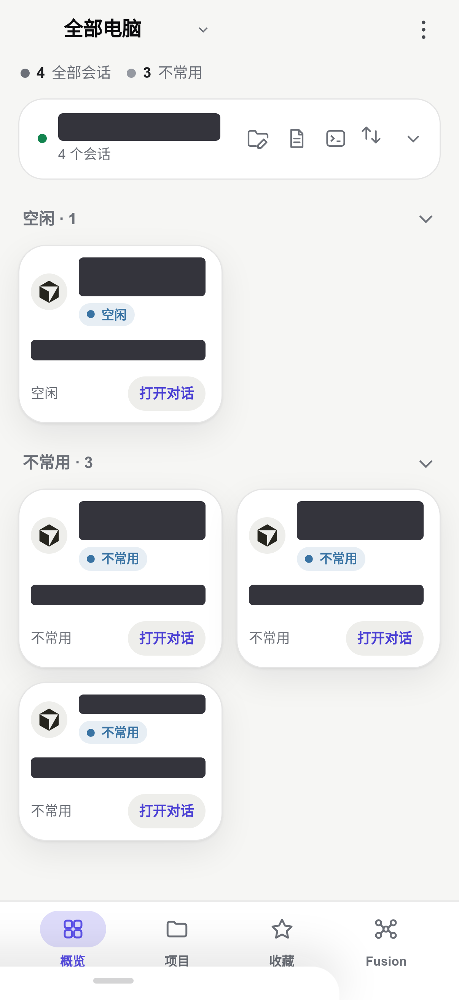
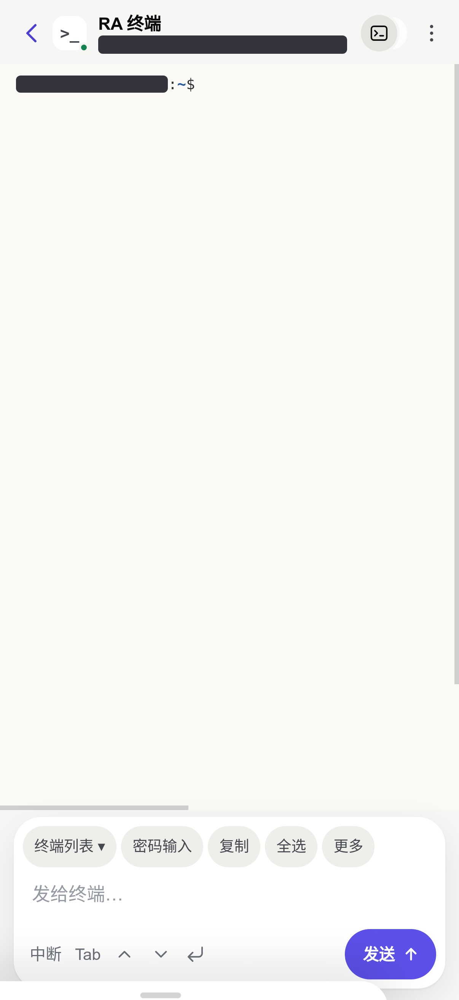
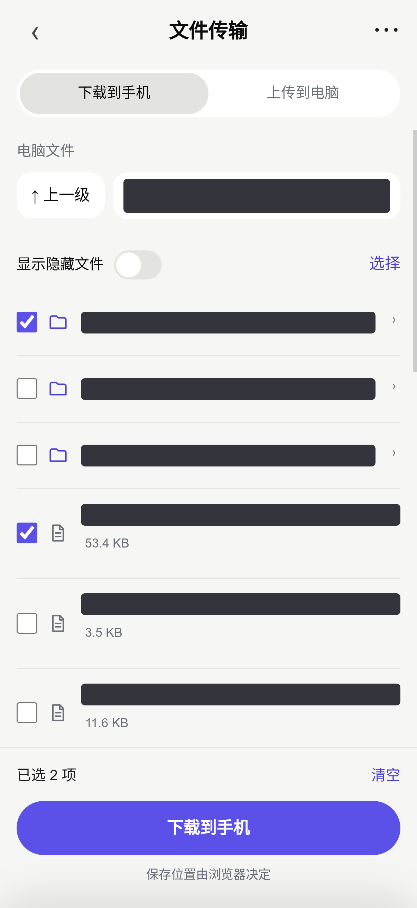
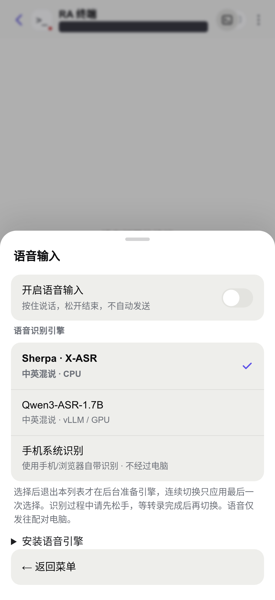

# Remote Agent

**Turn your phone into a remote control for Cursor, Devin and Codex.**

Remote Agent (RA) runs a relay on your own computer and connects to desktop Agents through the Chrome DevTools Protocol (CDP). From your phone, you can read streaming responses, continue conversations, answer questions and handle execution approvals, as well as edit files, operate an independent terminal and transfer files. Fusion provides a persistent main workspace where a main Agent manages multiple work items and calls native subagents.

Connect from a browser, a Progressive Web App (PWA), or the Android / iOS native shells. Keep the computer on, sign in to your desktop Agents and enable their debug ports. You remain responsible for the Agents' accounts, subscriptions and usage charges.

[Installation and pairing](#installation-and-pairing) · [Features](#features) · [Fusion](#fusion) · [User guide](docs/usage.en.md) · [Security](docs/security.en.md) · [中文](README.md)

<p align="center">
  
  
</p>

Above: the session overview and the initial RA terminal screen. All four images in this README were captured on **2026-11-05** from the real `v411` UI, using an Ubuntu relay and an already paired Chrome browser at 402×874 CSS pixels with 3× output. Private information is redacted. The source has since adopted a new Fusion navigation icon; the screenshot retains the icon used at capture time. These images illustrate the UI and do not constitute physical-phone acceptance testing; the terminal image does not demonstrate command execution. Historical chat and model-menu images are not used to represent the current UI. See the [screenshot notes](docs/screenshots/README.md) for capture limitations.

## Installation and pairing

### Requirements

- **Node.js 22+** and at least one installed, signed-in desktop Agent: Cursor, Devin Desktop, or VS Code with the Codex extension. Start only the applications you need.
- **Chrome, Edge or Chromium** on the computer, with an available graphical desktop, to open the separate pairing approval window.
- A phone browser that supports HTTPS and device-key storage, or a native shell.
- **`cloudflared`** for the public-access launchers below. A personal fixed entry page also needs **GitHub CLI (`gh`)** and your own GitHub account. A temporary tunnel needs no GitHub login.

```bash
git clone https://github.com/xrdiao/remote-agent.git
cd remote-agent
npm install
```

### Ubuntu launchers

From the repository directory, run:

```bash
./ubuntu_start/start-agents.sh
./ubuntu_start/pair.sh
```

The first command starts installed copies of Cursor, Devin and VS Code in parallel, skips missing applications and reuses debug ports that are already ready. You can also select applications explicitly:

```bash
./ubuntu_start/start-agents.sh cursor codex
```

If an application is already running without its debug port, the launcher asks you to quit it yourself and retry. Open the Codex sidebar in VS Code so RA can discover it.

The second command opens the unified pairing launcher. Choose a fixed entry page or a temporary tunnel entry; the launcher checks or configures your personal entry, starts or reuses the relay and tunnel in the background, then generates pairing information. A fixed entry uses a GitHub Pages site under your own account, and the launcher asks before creating one. The fixed page uses an encrypted address record to find the computer when the tunnel address changes. Closing the pairing launcher terminal leaves the background relay and tunnel running.

### Windows launchers

After installing dependencies, double-click `window_start/start-agents.exe` or run `window_start/start-agents.cmd`, then double-click `window_start/pair.exe` or run `window_start/pair.cmd`. These launchers use the repository's PowerShell / Node.js startup flow and support both fixed entry pages and temporary tunnels.

To start only selected applications, run this in PowerShell:

```powershell
powershell.exe -NoProfile -ExecutionPolicy Bypass -File .\window_start\start-agents.ps1 -Apps cursor,codex
```

### macOS and manual startup

Enable the debug port for each application you need:

| Agent | Default port | Startup |
|---|---|---|
| Cursor | 9222 | Linux: `cursor --remote-debugging-port=9222`; macOS: `./scripts/start-cursor.sh`; Windows: use the launchers above |
| Devin Desktop | 9223 | Linux: `./scripts/start-devin.sh`; other platforms: add `--remote-debugging-port=9223` to the actual desktop executable |
| Codex (VS Code extension) | 9224 | Linux / macOS: `./scripts/start-codex.sh`; Windows: `code --remote-debugging-port=9224`; open the Codex sidebar after startup |

If an application is running without its port enabled, save your work and quit it first. **On macOS, `start-cursor.sh` quits and restarts Cursor.** See the [installation guide](docs/getting-started.en.md) for port and executable-path configuration.

On macOS, you can also run the unified pairing launcher directly to prepare the relay and tunnel in the background:

```bash
node cli/desktop-pair.mjs
```

To run the relay in the foreground instead:

```bash
npm run public
```

Leave that terminal running. In another terminal, generate pairing information for the current HTTPS tunnel:

```bash
npm run pair -- --temporary
```

If you have configured a personal fixed entry, use `npm run pair`. The `npm run setup` wizard configures the fixed entry and optional two-step verification; you still need to start the desktop Agent and relay.

### Complete pairing and reconnect

1. Keep the computer's pairing window open. Scan the QR code with your phone or open the pairing link; alternatively, enter the full manual pairing code at the corresponding entry page. Pairing information is valid for **3 minutes**. Generating new information invalidates the previous unexpired link.
2. Compare the verification codes on the phone and in the computer's pairing window, then click “Allow connection” on the computer. If two-step verification is enabled, also enter the Authenticator code. Scanning alone does not grant control.
3. Once connected, view session cards in Overview, or use Projects to open a project and create or switch sessions. The computer row provides access to projects, files, the RA terminal and file transfer.
4. Reuse the same authorized entry later. On iPhone, add the page to the home screen in Safari; on Android, install the PWA. Browser, PWA and native-shell entries have their own authorizations. You can invite additional entries from an already paired entry, verify the code and approve them.

Ending pairing, closing the pairing window or pressing Ctrl+C only ends that pairing attempt; approved entries can still connect. Preserve `~/.agent-remote/` on the computer and the phone entry's authorization data. When a temporary tunnel address changes, obtain updated connection information; a fixed entry keeps its address.

`npm start` starts the relay without creating an HTTPS tunnel. **Plain HTTP LAN addresses cannot complete the current device-key authentication flow**, and `npm run pair -- --lan` rejects plain HTTP. Provide an HTTPS entry for a LAN deployment. Browser microphone access, camera scanning, Web Push and offline caching also require a secure context. See the [installation guide](docs/getting-started.en.md) for dependencies, HTTPS deployment and troubleshooting.

## Features

| Feature | What you can do today |
|---|---|
| Session overview | View session cards by computer, grouped by states such as awaiting input, running, completed, idle and infrequent; expand readable conversation previews, inspect tool progress and changes, and reply directly; open the full conversation to continue |
| Projects, favorites and batch management | Browse by project; open or create projects and sessions; favorite sessions and batch-favorite or delete/archive them; native session menus also offer All / Common filters and common-session settings, with renaming and deletion/archiving subject to Agent support |
| Conversations and execution controls | Read streaming responses, thinking, tool execution and history, and copy content; choose preset Question answers or enter your own, handle execution approvals, and queue input, edit the queue, append immediately or stop generation where supported |
| Models, permissions and usage | Use native model, reasoning-effort, parameter and permission menus; view context usage, quota and model pricing when the native application provides them |
| Codex capacity retry | Read capacity warnings and use the native Retry action; automatic clicking is off by default and can be limited to 1–5 clicks for the same warning |
| File editing and previews | Browse project files, inspect syntax highlighting, Git markers and diffs, and search within a file; edit and save local text files in projects that have been opened; preview images, local PDFs and MP4s |
| Images and attachments | Upload phone images and documents, attach multiple images, crop and annotate them; view original chat images and reference files through `@` or “Add computer file” |
| Independent RA terminal | Create, switch and close interactive shells on the paired computer; send commands, use Tab completion, recall history and send control keys; enter passwords, copy/select all and adjust logical terminal dimensions; restore the terminal display after refresh or reconnection while the relay remains running |
| File management and two-way transfer | Select downloads across directories and package folders as ZIP; upload batches of files or folders with progress, cancellation and retries for failed items; save under a new name, skip or overwrite collisions; create files/folders, copy, cut and paste, and compress or extract ZIP archives |
| Voice input | Hold to speak and release to finish; insert mixed Chinese/English transcription into the draft without sending automatically; choose Sherpa / Qwen on the computer or phone system recognition |
| Plot and simulation viewing | On Windows / Linux, view Matplotlib, Isaac Sim, MuJoCo and similar plot or simulation windows in read-only mode, with window selection, zoom and refresh; on Wayland, select a shared window through desktop authorization |
| Fusion collaboration | Use a native main conversation to manage multiple work items over time; arrange main-Agent or subagent execution according to dependencies, and inspect assignments, native content, results and acceptance evidence |
| Notifications, connections and appearance | Receive completion and approval-needed notifications that open the corresponding conversation; switch computers, invite entries and group devices, enable optional two-step verification, choose light/dark themes or Chinese/English, and install on the home screen |

Models, permissions, approvals, session actions and sending modes depend on the Agent, desktop version and actual window capabilities. Favorites and native “Common” sessions are separate features; file transfer is separate from chat attachments. The relay owns terminal processes: restarting it does not preserve the shells, and output history is limited by the terminal buffer. Folder upload depends on the phone browser's support.

<details>
<summary>File transfer and voice UI</summary>

<p align="center">
  
  
</p>

The file image shows the selection UI; no transfer was performed. The voice image shows installed engines; no recording or engine switch was tested. See the [user guide](docs/usage.en.md) for more operations.

</details>

## Optional capabilities and platform requirements

| Capability | Installation or runtime requirements |
|---|---|
| RA terminal | Uses the computer account's shell, initialized with Bash's `--rcfile` and Readline integration. Only the initial Ubuntu UI was captured; terminal support for other shells/platforms remains to be verified. The initial directory must be local to the computer |
| Sherpa CPU voice | `npm run voice:setup`; Python 3.10+, approximately 615 MB of model files plus runtime dependencies |
| Qwen3-ASR-1.7B voice | `npm run voice:setup -- --engine qwen`; the current installer requires Linux / NVIDIA GPU and uses the official vLLM streaming interface; approximately 4 GB of model files plus runtime dependencies |
| Browser recording | HTTPS, microphone permission and the selected engine installed on the computer; selecting an engine and opening the microphone are separate operations |
| Phone system recognition | Requires support in the browser or native shell; bypasses the computer's speech engine, with network use determined by the phone OS/browser |
| Windows plot/simulation viewing | FFmpeg with `gdigrab hwnd=` support |
| Linux X11 plot/simulation viewing | FFmpeg, `xprop` and system Python 3 |
| Linux Wayland plot/simulation viewing | Desktop-sharing authorization, PyGObject and GStreamer / PipeWire |
| Notifications | Web Push for browsers, a notification event stream for the Android shell, and an APNs forwarding service for the iOS shell; availability depends on permissions, background execution and service configuration |

The voice installer asks for confirmation, creates an isolated Python virtual environment, and downloads models and dependencies. Local engines process audio on the computer; Qwen's initial loading and readiness may take time. See the [voice guide](docs/voice-input.en.md). Native shells require separate builds or updates; publishing the web UI does not upgrade installed shells. For iOS push deployment, see [push-service/README.md](push-service/README.md).

## Fusion

Fusion is RA's persistent main workspace. You always converse with one native main Agent, which interprets requirements, plans and reviews work, and calls native subagents as needed. **Currently, only Codex can be the main Agent; subagents can use Cursor, Devin or Codex.** Each application needs an available desktop window and actual model candidates. Fusion in Devin's own model menu is a separate native capability.

### Getting started

1. Open Fusion from the bottom navigation, select the execution computer, enable a main workspace, and open an existing project or create one. RA reuses the project's window or follows the normal project-opening flow if none exists. Confirm project trust when required.
2. Load the native model candidates, select the main model, an available reasoning effort and a cost preference, then enable the main Agent. This creates a separate native main session.
3. Enter your requirements in the main conversation. The main Agent can manage multiple work items over time, each with a goal, scope, plan and acceptance criteria. Confirm plans according to project rules and existing authorization; assignments within an approved scope do not require repeated confirmation.
4. Open Agent relationships and responsibilities, or Tasks and evidence, to inspect dependencies, execution applications and models, native conversations, execution records, cost rationale and acceptance results for each criterion. You can add requirements, answer questions, handle native approvals, stop tasks or verify their state and continue.

The main session uses the regular conversation's model, permission, file and terminal controls. Subagent sessions retain context and can be continued for the same task; there is no fixed number of turns alternating between two applications. The main Agent can also register work and execute it directly in its actual project, while work in other projects can be delegated through work items.

### Assignments, cost and permissions

- **Dependencies determine scheduling.** The main Agent chooses sequential or parallel execution based on inputs, outputs, shared files, commands and other resources. Tasks in the same application may run in parallel, and tasks in different applications may run sequentially. Recorded scopes do not lock files; the main Agent must identify conflicts. Each workspace belongs to a specific execution computer, and the phone can switch between workspaces on multiple computers.
- **Cost preferences are Economy, Balanced and Performance.** Decisions compare estimated total costs of direct execution, delegation, planning, review, context transfer and rework. Model candidates and quotes come from actual native data. An optional budget requires verifiable native units and quotes. Unknown amounts remain unknown; account-wide usage is not a per-task bill.
- **Scope authorization and native approvals are handled separately.** Project `AGENTS.md` rules, the user-approved scope and the desktop Agent's permission approvals remain in effect. Authorizing an assignment does not approve native permissions. Fusion prompts instruct main and subagents not to create nested delegations or worktrees, or independently merge, commit, push or publish.
- **Completion requires evidence.** After execution ends, the main Agent reviews the result against acceptance criteria and continues the task for rework when needed. Queuing, native acceptance, execution completion and review acceptance are recorded separately. Stopping, disconnection, exhausted quota or an unknown result do not count as completion; recovery first checks the native execution state.

For implementation and state details, see the [Fusion Super Agent document](docs/fusion-super-agent-20261105.md) (Chinese). The source and actual runtime results determine the current UI and available operations.

## How it works and security

```text
Phone browser / PWA / native shell
          | HTTPS fixed entry or tunnel
          v
    Local relay (default 3939)
          | CDP debug connections
          +-- Cursor        9222
          +-- Devin Desktop 9223
          +-- VS Code/Codex 9224
```

A personal fixed entry hosts the phone web UI and encrypted computer-address records. The phone connects to the local relay for conversations and operations. The relay creates local pseudoterminals (PTYs) for RA terminals; file transfer uses separate HTTP endpoints. Fusion's main and subagents execute in real native sessions.

Each authorized entry holds its own device key. Connections and operations require both a token and a key signature; copying a connection token alone does not transfer the device key. Optional two-step verification uses time-based one-time passwords (TOTP):

```bash
npm run 2fa
npm run devices
npm run devices -- remove <device-id>
```

RA can operate real files and terminals accessible to the computer's current user. Pair only trusted entries and protect `~/.agent-remote/`, pairing links, manual pairing codes, tokens and debug ports. Device groups organize entries; each entry still requires authentication. See the [security guide](docs/security.en.md).

## Documentation and development

| Document | Contents |
|---|---|
| [Installation guide](docs/getting-started.en.md) | Dependencies, platform commands, fixed entries, pairing and troubleshooting |
| [User guide](docs/usage.en.md) | Project sessions, attachments, terminals, files and screen viewing |
| [Voice input](docs/voice-input.en.md) | Engine installation, switching and microphone requirements |
| [Security guide](docs/security.en.md) | Connections, device entries, pairing and two-step verification |
| [Screenshot notes](docs/screenshots/README.md) | Real capture environment, redaction and historical-image limitations |
| [Feature baselines](docs/baselines/README.md) (Chinese) | Feature reference and navigation for checks and changes |
| [Fusion implementation](docs/fusion-super-agent-20261105.md) (Chinese) | Main workspace, native sessions, tasks and review records |
| [Known issues and fixes](docs/problem.md) (Chinese) | Issue background and resolution records |

Detailed guides and design records may contain older workflows. Use this README, the source and the actual UI for current entry points and feature boundaries.

Source directories: `server/` for the relay, application adapters and Fusion; `app/` for the phone web UI; `lib/` for shared authentication, file and notification capabilities; `cli/` for setup and pairing tools; `ubuntu_start/` and `window_start/` for platform launchers; `android/` and `ios/` for native shells; `push-service/` for iOS push forwarding.

Development checks:

```bash
npm run check
```

This command checks syntax, message protocols and the injected-script export snapshot, then runs automated tests. See [AGENTS.md](AGENTS.md) for modification rules, physical-device acceptance of affected features, and native build/release conventions.

## License and acknowledgements

[MIT License](LICENSE). Reference project: [cursor-remote-lite](https://github.com/Suchenl/cursor-remote-lite).
