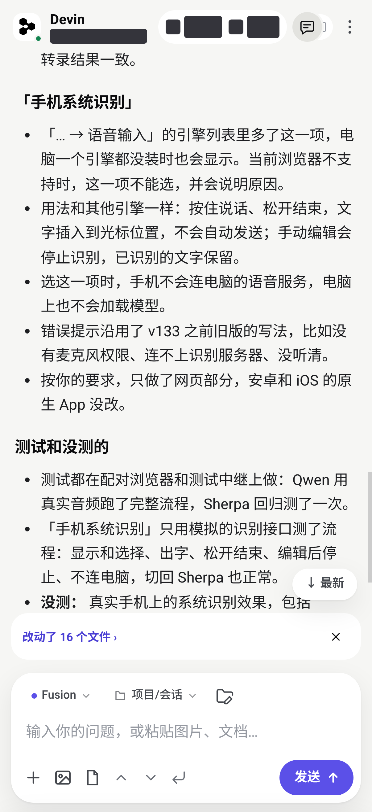
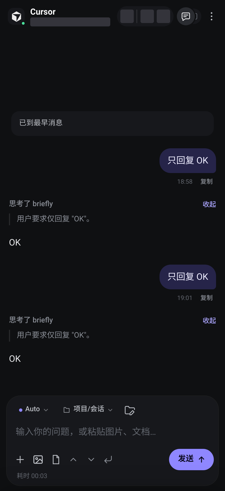
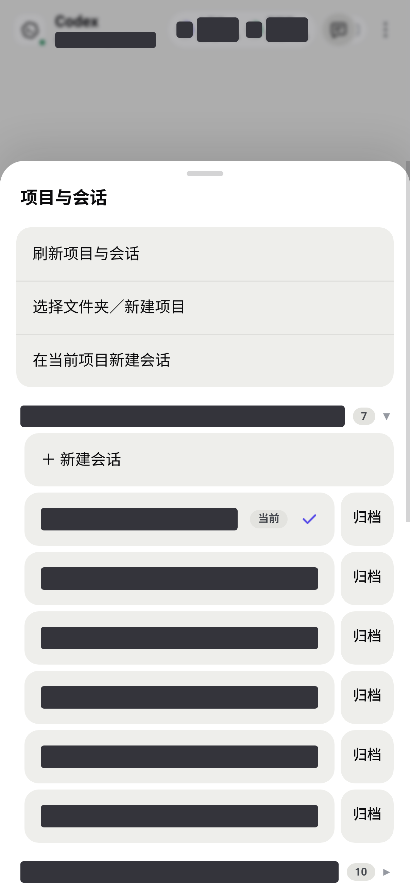
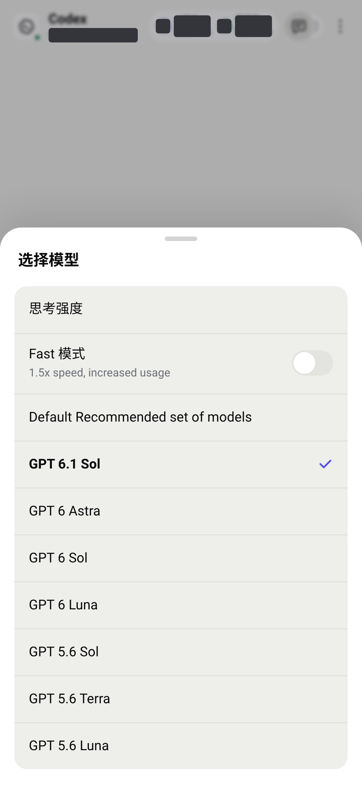
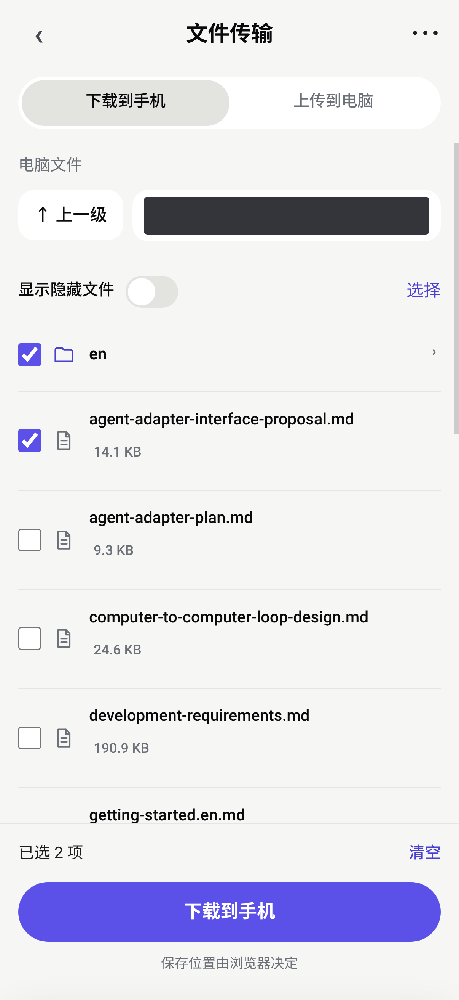
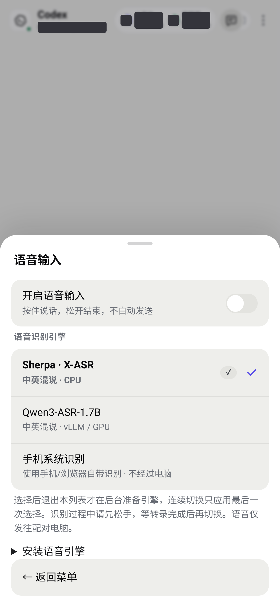

# Remote Agent

**把手机变成 Cursor、Devin 和 Codex 的遥控器。**

查看流式对话、管理项目与会话、回答提问、批准执行、语音输入、编辑和传输文件，也可以用 Fusion 让两个 Agent 协作。中继运行在你自己的电脑上；手机可使用浏览器、PWA 或 Android / iOS 壳。

[快速开始](#快速开始) · [功能](#现有功能) · [使用指南](docs/usage.md) · [语音输入](docs/voice-input.md) · [安全说明](docs/security.md) · [English](README.en.md)

<p align="center">
  
  
</p>

> 本工具自托管，不替代 Agent 本身的账号或订阅。电脑需要保持开机，并以调试端口启动要使用的桌面应用。

## 现有功能

| 功能 | 可以做什么 |
|---|---|
| 多 Agent 对话 | 连接 Cursor、Devin、Codex，查看流式回复、思考、工具执行和历史记录，复制回复；按 Agent 选择是否显示执行指令及工具记录 |
| 项目与会话 | 按项目浏览、新建和切换会话；通过「全部／常用」筛选会话，星标设置或取消常用；Codex 会话还支持重命名及删除／归档 |
| 模型与用量 | 切换原生模型、思考强度和可用参数，查看上下文占用、剩余额度及模型价格（原生提供时） |
| Codex 容量重试 | 查看模型容量不足提示，操作桌面端提供的 Retry；可选择自动重试并设置每条提示最多点击 1–5 次，默认关闭 |
| 提问与审批 | 在手机选择 Question 预设答案或填写自定义回答，批准或拒绝终端执行；生成中按 Agent 能力排队、编辑队列或立即追加 |
| 项目文件与预览 | 通过 Editor 浏览和编辑项目文件；查看代码高亮、改动文件及差异，搜索文件内容；预览图片、本机 PDF 和 MP4 视频 |
| 图片与附件 | 上传手机图片和文档，批量附图、裁剪及标注，点击聊天缩略图查看原图；通过 `@` 或「添加电脑端文件」引用项目及电脑文件 |
| 终端 | 查看输出、输入命令及交互内容，切换终端、复制输出、调用历史和发送控制键 |
| 双向文件传输 | 跨目录批量选择，下载文件或将文件夹打包为 ZIP；批量上传文件及文件夹至指定电脑目录，支持进度、取消、失败重试和重名处理 |
| 中英混说语音 | 按住说话、松开收尾，实时插入草稿；选择 Sherpa CPU、Qwen GPU 或可用的手机系统识别 |
| 绘图与仿真画面 | 只读查看 Matplotlib、Isaac Sim、MuJoCo 等窗口，支持窗口选择、缩放和刷新 |
| Fusion 协作 | 选择项目及 A／B 的 Agent、会话和模型；A 负责方案与检查，确认方案后由 B 执行，再评审和修正；可查看进度、改动及历史，停止任务，检查时选择完成、小修或退回 B |
| 通知 | 接收任务完成和待确认提醒，点击进入对应窗口及会话；具体可用能力取决于浏览器、系统权限和推送服务配置 |
| 连接与外观 | 固定入口、电脑切换、设备分组与入口管理、可选两步验证；从已配对设备生成二维码和授权链接，核对验证码后批准新入口；深浅主题、中英文和主屏幕安装 |

具体选项以对应 Agent、桌面版本和当前窗口实际提供的能力为准。文件传输独立于聊天附件；画面功能只读；Fusion 协作与 Devin 原生 Fusion 模型模式不同。详见[使用指南](docs/usage.md)。

<details>
<summary>查看更多界面：项目会话、模型、文件传输与语音</summary>

<p align="center">
  
  
</p>
<p align="center">
  
  
</p>

</details>

截图来自配对 Chrome 的 iPhone 17 尺寸模拟：402×874 CSS 像素、3 倍输出，已脱敏；不代表 iPhone 真机验收。[截图说明](docs/screenshots/README.md)

## 快速开始

需要 **Node.js 22+**、至少一个已安装并登录的桌面 Agent，以及手机浏览器。公网访问另需 `cloudflared`；配置个人固定入口还需 GitHub CLI（`gh`）。

```bash
git clone https://github.com/xrdiao/remote-agent.git
cd remote-agent
npm install
```

### Ubuntu 快捷入口

```bash
./ubuntu_start/start-agents.sh
./ubuntu_start/pair.sh
```

先启动已安装的 Agent，再按提示选择个人固定入口或临时隧道并配对。临时入口无需 GitHub 登录；固定入口使用你自己的 GitHub 账号。启动器复用已运行服务，关闭启动器终端不关闭后台中继。

### Windows 快捷入口

使用 `window_start/start-agents.cmd` 启动 Agent，再双击 `window_start/pair.exe` 或运行 `window_start/pair.cmd`。配置固定入口前安装并登录 `gh`；安装和依赖见[完整教程](docs/getting-started.md)。

### 手动启动：Linux / macOS / Windows

先为所需 Agent 开启调试端口，**无需全部启动**：

| Agent | 默认调试端口 | 启动方式 |
|---|---|---|
| Cursor | 9222 | Linux：`cursor --remote-debugging-port=9222`；macOS：`./scripts/start-cursor.sh`；Windows 见完整教程 |
| Devin Desktop | 9223 | Linux：`./scripts/start-devin.sh`；其他系统为可执行文件添加 `--remote-debugging-port=9223` |
| Codex（VS Code 插件） | 9224 | Linux/macOS：`./scripts/start-codex.sh`；Windows：`code --remote-debugging-port=9224`；打开 Codex 侧边栏 |

已运行但没有调试端口时，先保存工作并自行退出。macOS 的 Cursor 脚本会退出后重启应用。

```bash
npm run public
```

保持中继终端运行，另开一个终端生成配对信息：

```bash
npm run pair
```

用手机扫描二维码，或打开自己的固定入口输入完整手动配对码。配对后使用同一入口，保留电脑上的 `~/.agent-remote/`。iPhone 可在 Safari 中添加到主屏幕，Android 可安装 PWA；原生壳构建说明见下方文档。

只在同一局域网使用可运行 `npm run start` 和 `npm run pair -- --lan`。普通 HTTP 不能使用网页麦克风、相机扫码、Web Push 和离线缓存等需要安全上下文的能力。安装依赖、PowerShell 命令、设置向导、固定入口及故障排查见[安装教程](docs/getting-started.md)。

## 可选功能与平台要求

| 功能 | 额外要求 |
|---|---|
| Sherpa 中英混说 | `npm run voice:setup`；Python 3.10+，CPU 可用，模型约 615 MB |
| Qwen3-ASR-1.7B | `npm run voice:setup -- --engine qwen`；当前安装入口要求 Linux / NVIDIA GPU，模型约 4 GB，依赖另计 |
| 网页录音 | HTTPS、浏览器麦克风权限；只预热选中的模型，不提前打开麦克风 |
| Windows 画面 | 支持 `gdigrab hwnd=` 的 FFmpeg |
| Linux X11 画面 | FFmpeg、`xprop`、系统 Python 3 |
| Linux Wayland 画面 | 桌面共享授权、PyGObject、GStreamer / PipeWire |
| 通知与原生扩展 | 取决于浏览器、系统权限及推送服务；网页发布不升级已安装的壳 |

语音依赖安装在独立虚拟环境，不修改系统显卡驱动或 CUDA；Qwen 冷启动更久，切换与首次就绪需要等待。手机系统识别是否联网由浏览器/系统决定。[语音详情](docs/voice-input.md) · [画面及文件使用](docs/usage.md)

## 工作原理与安全

```text
手机浏览器 / PWA / 原生壳
          │ HTTPS 隧道或局域网
          ▼
    本机中继（默认 3939）
          │ CDP 调试连接
          ├── Cursor        9222
          ├── Devin Desktop 9223
          └── VS Code/Codex 9224
```

Fusion 复用这些 Agent 的连接进行协作。语音在所选引擎中处理，文件传输使用独立 HTTP 接口。

工具可操作当前电脑用户的真实文件和终端。只配对可信入口，勿公开配对码、令牌或调试端口；可用 `npm run 2fa` 开启两步验证、`npm run devices` 查看并撤销授权。不同浏览器使用独立凭据，可以从已有可信入口邀请授权；设备分组不绕过认证。详见[安全说明](docs/security.md)。

## 文档与开发

- [安装、启动、配对、常用命令与故障排查](docs/getting-started.md)
- [项目会话、终端、附件、文件传输、画面与 Fusion](docs/usage.md)
- [语音安装、引擎切换与麦克风要求](docs/voice-input.md)
- [连接、设备入口与安全](docs/security.md)
- [Windows Devin 维护](docs/windows-devin-maintenance.md)

目录：`server/` 中继与适配器，`app/` 手机网页，`lib/` 公共能力，`cli/` 配置工具，`android/` 和 `ios/` 原生壳，`push-service/` iOS 推送服务。

开发检查：`npm run check`。原生构建与发布约定见 [AGENTS.md](AGENTS.md)；iOS 推送部署见 [push-service/README.md](push-service/README.md)。

## 许可与致谢

[MIT License](LICENSE)。参考项目：[cursor-remote-lite](https://github.com/Suchenl/cursor-remote-lite)。
