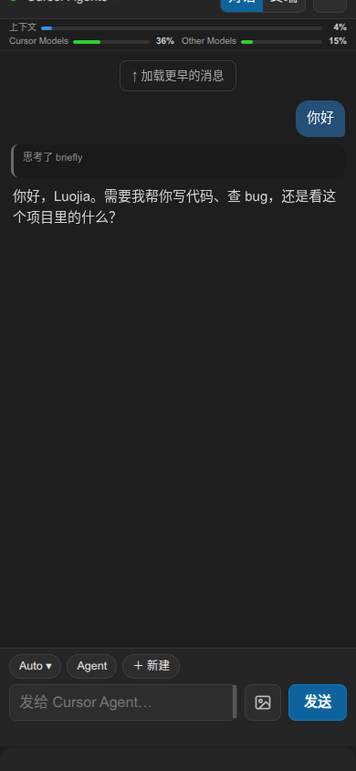
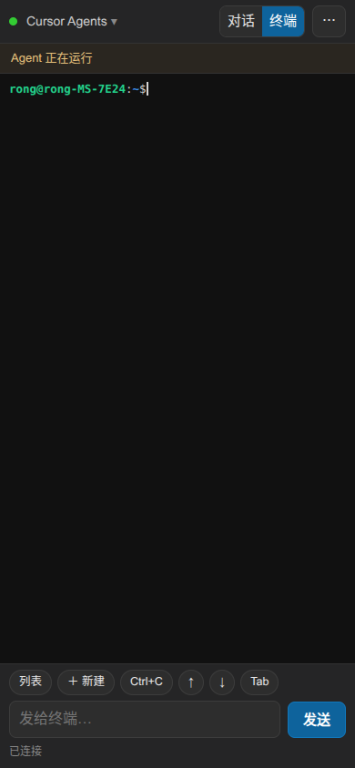

# Remote Agent

用手机操作这台电脑上的 Cursor 和 Devin。对话、切换 Agent 和模型、看终端、批准确认，都在手机浏览器里完成。两个程序在手机的窗口列表里切换。

<p>


</p>

参考仓库：[https://github.com/Suchenl/cursor-remote-lite](https://github.com/Suchenl/cursor-remote-lite)

## 这台机器上怎么用

需要 Node.js 22 或更高版本，以及本机的 `cloudflared`（放在 `~/.local/bin`，不改系统环境）。

1. 让 Cursor 打开调试端口后再启动（端口默认 `9222`）：

```bash
cursor --remote-debugging-port=9222
```

2. 启动 Devin，并打开它自己的调试端口（默认 `9223`）。这不会关掉 Cursor，也不会关掉已经开着调试端口的 Devin：

```bash
./start-devin.sh
```

如果 Devin 已经在运行，但没有调试端口，先退出 Devin，再运行一次这个脚本。

3. 安装依赖并打开公网隧道：

```bash
npm install
npm run public
```

4. 配对手机。终端会打印一次性链接，用手机 Safari 打开：

```bash
npm run pair
```

配对记录保存在电脑上的 `~/.cursor-remote-lite/`。公网隧道单独在后台运行，之后重启 `npm run public` 会沿用同一个地址，已配对的手机不用重新配对。只有关机，或手动结束隧道进程，地址才会变。

终端里会打印隧道进程号。要彻底关掉公网：

```bash
kill <隧道进程号>
```

只在局域网用时，把 `npm run public` 换成 `npm run start`。

## 手机上能做什么

- 看 Agent 对话，回车发送，Shift+回车换行。
- 切换 Agent 和模型。旧版 Cursor 在输入框旁有「历史」，用来打开这一条 Agent 里以前的聊天。现在 Cursor Agents 和 Devin 都把这些会话放在左侧列表里，手机上用「Agent」切换，工具栏不再放「历史」。
- 看终端文字，新建、切换、关闭终端，并执行命令。
- 看上下文占用和额度。额度条点一下会重新读取。
- 对话里的公式按数学式显示。代码块可以点「复制」，较长的行内命令点一下也会复制。
- 从手机附加图片到输入框。
- 在窗口列表里切换 Cursor 和 Devin。Devin 的会话显示为 Devin agent。

## 常用命令

| 命令 | 作用 |
|---|---|
| `npm run public` | 启动中继，并使用公网隧道 |
| `npm run start` | 只在本机或局域网启动 |
| `npm run pair` | 生成一次性配对链接 |
| `npm run devices` | 查看已配对设备 |
| `npm run 2fa` | 可选的 Authenticator 二次验证 |
| `./start-devin.sh` | 启动 Devin，并打开调试端口 9223 |

