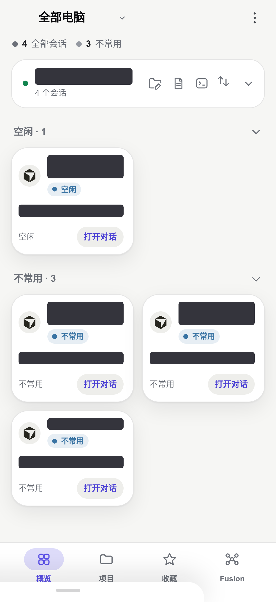
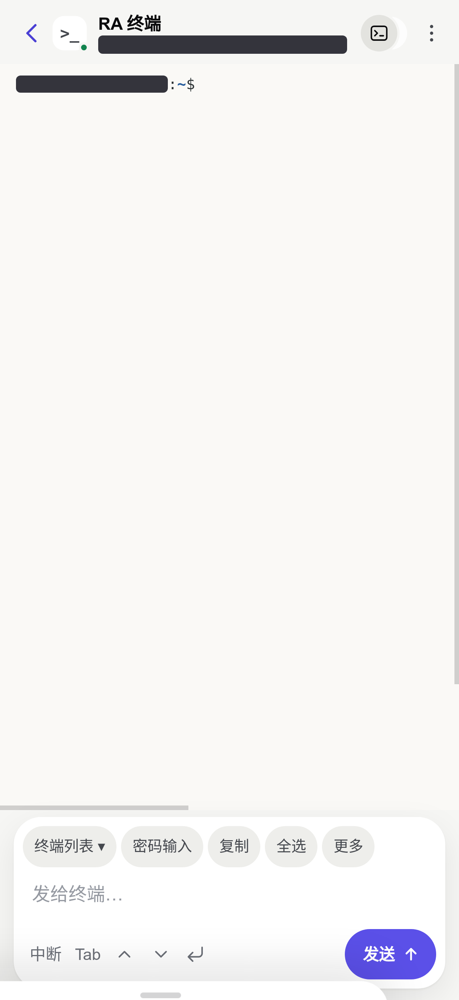
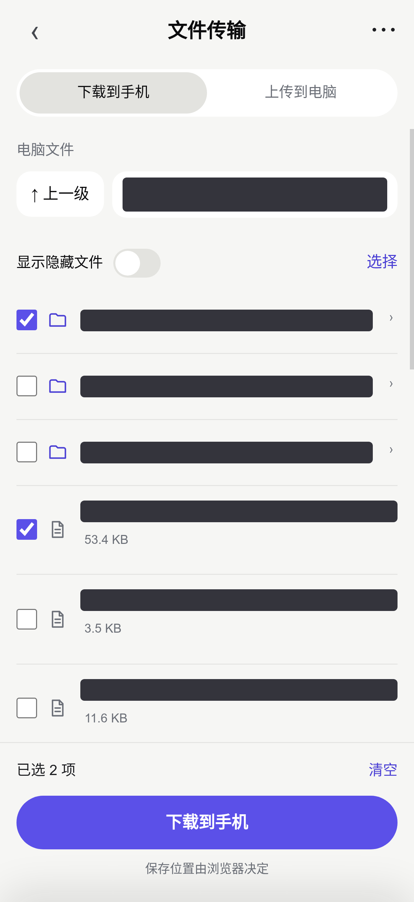
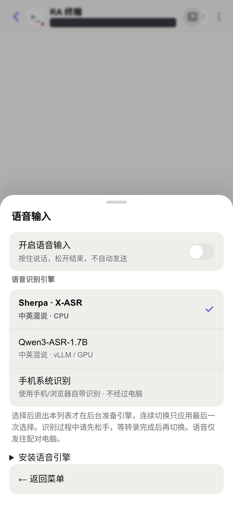

# Remote Agent

**把手机变成 Cursor、Devin 和 Codex 的遥控器。**

Remote Agent（RA）在自己的电脑上运行中继（relay），通过 Chrome 开发者工具协议（CDP）连接桌面 Agent。手机可查看流式回复、继续会话、回答提问和处理执行审批，也能编辑文件、操作独立终端、传输文件。Fusion 提供持续主工作台，让主 Agent 管理多个工作项并调用原生子 Agent。

手机端支持浏览器、渐进式网页应用（PWA）和 Android / iOS 原生壳。电脑需要保持开机，桌面 Agent 需要登录并开启调试端口；Agent 的账号、订阅和使用费用仍由你自行承担。

[安装与配对](#安装与配对) · [功能](#功能) · [Fusion](#fusion) · [使用指南](docs/usage.md) · [安全说明](docs/security.md) · [English](README.en.md)

<p align="center">
  
  
</p>

上图为会话概览与 RA 终端初始界面。本文四张图片均采集于 **2026-11-05**，来自 Ubuntu 中继与既有配对 Chrome 的真实 `v411` 页面，视口为 402×874 CSS 像素、3 倍输出，已脱敏。后续源码已更换 Fusion 导航图标，图中仍为采集时样式。图片用于展示界面；未进行手机真机验收，终端图未演示命令执行。历史聊天与模型菜单图未作为当前界面展示，采集限制见[截图说明](docs/screenshots/README.md)。

## 安装与配对

### 准备环境

- **Node.js 22+**，以及至少一个已安装、已登录的桌面 Agent：Cursor、Devin Desktop 或带 Codex 插件的 VS Code。这里只需启动实际使用的应用。
- 电脑安装 **Chrome、Edge 或 Chromium**，并有可用图形桌面，用于打开独立配对审批窗口。
- 手机使用支持 HTTPS 和设备密钥存储的浏览器，或原生壳。
- 使用下述公网快捷入口需安装 **`cloudflared`**；选择个人固定入口还需 **GitHub CLI（`gh`）**及自己的 GitHub 账号。临时隧道无需 GitHub 登录。

```bash
git clone https://github.com/xrdiao/remote-agent.git
cd remote-agent
npm install
```

### Ubuntu 快捷启动

在仓库目录运行：

```bash
./ubuntu_start/start-agents.sh
./ubuntu_start/pair.sh
```

第一条命令并行启动已安装的 Cursor、Devin、VS Code，跳过未安装的应用，并复用已经就绪的调试端口。也可以只启动指定应用：

```bash
./ubuntu_start/start-agents.sh cursor codex
```

若应用已运行却没开启调试端口，启动器会提示你自行退出后重试。在 VS Code 中打开 Codex 侧边栏，使其可被发现。

第二条命令进入统一配对启动器：选择「固定入口」或「临时隧道入口」，检查或配置个人入口，后台启动或复用中继与隧道，再生成配对信息。固定入口使用自己账号下的 GitHub Pages 页面，创建新入口前会询问；隧道地址变化后，固定页面通过加密地址记录寻找电脑。关闭快捷配对终端不关闭已启动的后台中继和隧道。

### Windows 快捷启动

在安装依赖后，双击 `window_start/start-agents.exe` 或运行 `window_start/start-agents.cmd`；再双击 `window_start/pair.exe` 或运行 `window_start/pair.cmd`。这些入口使用仓库内的 PowerShell / Node.js 启动流程，同样支持固定入口和临时隧道。

只启动部分应用时，可在 PowerShell 中运行：

```powershell
powershell.exe -NoProfile -ExecutionPolicy Bypass -File .\window_start\start-agents.ps1 -Apps cursor,codex
```

### macOS 与手动启动

先为需要的应用开启调试端口：

| Agent | 默认端口 | 启动方式 |
|---|---|---|
| Cursor | 9222 | Linux：`cursor --remote-debugging-port=9222`；macOS：`./scripts/start-cursor.sh`；Windows 使用上述启动器 |
| Devin Desktop | 9223 | Linux：`./scripts/start-devin.sh`；其他平台为实际桌面可执行文件添加 `--remote-debugging-port=9223` |
| Codex（VS Code 插件） | 9224 | Linux / macOS：`./scripts/start-codex.sh`；Windows：`code --remote-debugging-port=9224`；启动后打开 Codex 侧边栏 |

已运行但没开启端口的应用，需要先保存工作并退出。**macOS 的 `start-cursor.sh` 会退出并重启 Cursor**。端口、可执行文件路径等配置见[安装教程](docs/getting-started.md)。

macOS 也可直接使用统一配对启动器，让它在后台准备中继和隧道：

```bash
node cli/desktop-pair.mjs
```

若希望在前台运行中继，使用：

```bash
npm run public
```

保持该终端运行，另开终端为本次 HTTPS 隧道生成配对信息：

```bash
npm run pair -- --temporary
```

已配置个人固定入口时，使用 `npm run pair`。`npm run setup` 是固定入口、可选二次验证等设置向导；它不代替启动桌面 Agent 和中继。

### 完成配对与日常连接

1. 保持电脑配对窗口打开，用手机扫描二维码，或打开配对链接；也可在对应入口输入完整手动配对码。配对信息有效期为 **3 分钟**，重新生成会作废上一条尚未过期的链接。
2. 对照手机与电脑配对窗口上的验证码，在电脑点击「允许连接」。开启二次验证时，还需输入 Authenticator 验证码。仅扫码不会直接获得控制权。
3. 连接后，从「概览」查看会话卡片，或从「项目」打开项目、新建或切换会话。电脑行提供打开项目、文件、RA 终端和文件传输入口。
4. 日后使用已授权的同一入口；iPhone 可在 Safari 中添加到主屏幕，Android 可安装 PWA。浏览器、PWA 与原生壳等入口使用各自的授权，可从已配对入口邀请添加，并核对验证码批准。

配对结束、关闭配对窗口或按 Ctrl+C，只停止本次配对，已批准的入口仍可连接。保留电脑上的 `~/.agent-remote/` 和手机入口的授权数据；临时隧道地址变化后需重新获取连接信息，固定入口则保持原地址。

`npm start` 只启动中继，不创建 HTTPS 隧道。**不能用普通 HTTP 局域网地址完成当前的设备密钥认证**；`npm run pair -- --lan` 也会拒绝普通 HTTP。需要局域网部署时应先提供 HTTPS 入口。网页麦克风、相机扫码、Web Push 与离线缓存也依赖安全上下文。依赖安装、HTTPS 部署与故障排查见[安装教程](docs/getting-started.md)。

## 功能

| 功能 | 当前可以做什么 |
|---|---|
| 会话概览 | 按电脑查看会话卡片及需要确认、运行、完成、空闲、不常用等状态；展开可读会话预览、查看工具进度与改动，并直接输入回复；进入完整对话继续操作 |
| 项目、收藏与批量管理 | 按项目浏览，打开或新建项目与会话；收藏会话，批量收藏或删除／归档；原生会话菜单还提供全部／常用筛选、设置常用等操作，重命名及删除／归档取决于 Agent 支持 |
| 对话与执行控制 | 查看流式回复、思考、工具执行和历史，复制内容；选择 Question 预设答案或填写自定义回答，处理执行审批；按 Agent 能力排队、编辑队列、立即追加或停止生成 |
| 模型、权限与用量 | 操作原生模型、思考强度、可用参数和权限菜单；原生提供时显示上下文占用、额度与模型价格 |
| Codex 容量重试 | 读取容量不足提示并操作原生 Retry；自动点击默认关闭，可设为同一条提示最多点击 1–5 次 |
| 文件编辑与预览 | 浏览项目文件，查看代码高亮、Git 标记及改动差异，在文件内搜索；编辑和保存已打开项目中的本地文本文件；预览图片、本机 PDF 和 MP4 |
| 图片与附件 | 上传手机图片和文档，批量附图、裁剪及标注；查看聊天原图，通过 `@` 或「添加电脑端文件」引用文件 |
| RA 独立终端 | 在配对电脑新建、切换和关闭交互式 Shell，输入命令、Tab 补全、调用历史和控制键；密码输入、复制／全选、调整逻辑尺寸；中继运行期间可在刷新或重连后恢复终端画面 |
| 文件管理与双向传输 | 跨目录多选下载，文件夹打包为 ZIP；批量上传文件及文件夹，显示进度、取消和重试失败项；同名可另存、跳过或覆盖；也可新建文件／文件夹、复制、剪切粘贴、压缩或解压 ZIP |
| 语音输入 | 按住说话、松开结束，中英混说转录插入草稿，不自动发送；可选电脑上的 Sherpa / Qwen，或手机系统识别 |
| 绘图与仿真画面 | Windows / Linux 上只读查看 Matplotlib、Isaac Sim、MuJoCo 等绘图或仿真窗口，选择窗口、缩放和刷新；Wayland 通过桌面授权选择共享窗口 |
| Fusion 协作 | 以原生主对话持续管理多个工作项，按任务依赖安排自己执行或子 Agent 执行，查看分工、原生内容、结果与验收证据 |
| 通知、连接与外观 | 任务完成和待确认通知，点击定位对应会话；多电脑切换、入口邀请与设备分组、可选二次验证；深浅主题、中英文、主屏幕安装 |

模型、权限、审批、会话操作和发送方式以对应 Agent、桌面版本与实际窗口能力为准。收藏与原生「常用」是不同入口；文件传输独立于聊天附件。终端由中继持有，重启中继不保留 Shell 进程，输出回看受终端缓冲区限制；文件夹上传取决于手机浏览器支持。

<details>
<summary>文件传输与语音界面</summary>

<p align="center">
  
  
</p>

文件图展示多选下载页面，未实际执行传输；语音图展示已安装引擎，未录音或切换引擎。更多操作见[使用指南](docs/usage.md)。

</details>

## 可选能力与平台要求

| 能力 | 安装或运行要求 |
|---|---|
| RA 终端 | 当前使用电脑账号的 Shell，并按 Bash 的 `--rcfile` 和 Readline 方式初始化；本次仅有 Ubuntu 初始界面采图，其他 Shell／平台的终端能力尚待验证。初始目录须为电脑本地目录 |
| Sherpa CPU 语音 | `npm run voice:setup`；Python 3.10+，模型约 615 MB，运行依赖另计 |
| Qwen3-ASR-1.7B 语音 | `npm run voice:setup -- --engine qwen`；当前安装入口要求 Linux / NVIDIA GPU，使用官方 vLLM 流式接口，模型约 4 GB，运行依赖另计 |
| 网页录音 | HTTPS 和麦克风权限；电脑需已安装所选引擎。选择引擎与打开麦克风是独立操作 |
| 手机系统识别 | 浏览器或原生壳实际支持系统识别；不经电脑语音引擎，是否联网由手机系统／浏览器决定 |
| Windows 绘图／仿真画面 | 支持 `gdigrab hwnd=` 的 FFmpeg |
| Linux X11 绘图／仿真画面 | FFmpeg、`xprop`、系统 Python 3 |
| Linux Wayland 绘图／仿真画面 | 桌面共享授权、PyGObject、GStreamer / PipeWire |
| 通知 | 网页使用 Web Push；Android 壳使用通知事件流；iOS 壳使用 APNs 转发服务，具体可用性取决于权限、后台运行和服务配置 |

语音安装器会询问并创建独立 Python 虚拟环境，下载模型与依赖。本机引擎在电脑处理音频；Qwen 首次加载与就绪可能需要等待。详见[语音说明](docs/voice-input.md)。原生壳需要单独构建或更新，发布网页不会升级已安装的壳；iOS 推送部署见 [push-service/README.md](push-service/README.md)。

## Fusion

Fusion 是 RA 的持续主工作台。你始终与一个原生主 Agent 对话，由它理解需求、规划和验收，并在需要时调用原生子 Agent。**当前主 Agent 限 Codex；子 Agent 可使用 Cursor、Devin 或 Codex。**各软件必须有可用的桌面窗口与实际模型候选。Devin 自己模型菜单中的 Fusion 是另一项原生能力。

### 开始使用

1. 从底部「Fusion」进入，选择执行电脑，启用主工作台，打开已有项目或新建项目。RA 复用该项目的窗口；没有时走正常打开项目流程，需要时确认项目信任。
2. 读取原生模型候选，选择主模型、实际可用的思考强度和成本偏好，点击「启用主 Agent」。启用时创建独立原生主会话。
3. 在主对话输入需求。主 Agent 可持续管理多个工作项；每项记录目标、范围、计划与验收标准。按项目规则和已有授权确认方案，已确认范围内的分工不重复请示。
4. 打开「Agent 关系与分工」或「任务与证据」，查看任务依赖、执行软件与模型、原生对话、执行记录、成本理由和逐项验收。可补充需求、回答问题、处理原生审批、停止任务，或核对状态后继续。

主会话使用普通对话的模型、权限、文件与终端入口。子会话会保留上下文，同一任务可继续调用，不按固定轮数在两个软件间轮流转发。主 Agent 也能登记后直接执行自己实际项目中的工作，其他项目可通过工作项委派。

### 分工、成本与权限

- **分工按依赖安排。**主 Agent 根据输入产出、共享文件与命令等资源决定串行或并行。同软件也可并行，不同软件也可串行；任务范围记录不等于文件锁，需要主 Agent 识别冲突。一个工作台明确归属执行电脑，手机可切换查看多台电脑的工作台。
- **成本偏好有省钱、均衡、性能三档。**决策比较自己执行、委派以及规划、评审、上下文传递和返工的预计总成本；候选模型与报价来自实际原生资料。可选预算必须有可核实的原生单位与报价，未知金额保留未知，账号总用量不等于单任务账单。
- **授权与原生审批分别处理。**项目的 `AGENTS.md`、用户确认范围和桌面 Agent 的权限审批继续生效。派工授权不会自动批准原生权限；Fusion 提示要求主、子 Agent 不另行嵌套派工、不创建 worktree、不自行合并、提交、推送或发布。
- **完成以证据为准。**执行结束后交由主 Agent 按验收标准评审，必要时续接返工；排队、原生接受、执行结束和验收通过分别记录。停止、失联、额度不足或结果未知不算完成，恢复时先核对原生执行状态。

实现和状态细节可参考 [Fusion Super Agent 文档](docs/fusion-super-agent-20261105.md)；当前界面和可用操作以源码及实际运行结果为准。

## 原理与安全

```text
手机浏览器 / PWA / 原生壳
          │ HTTPS 固定入口或隧道
          ▼
    本机中继（默认 3939）
          │ CDP 调试连接
          ├── Cursor        9222
          ├── Devin Desktop 9223
          └── VS Code/Codex 9224
```

个人固定入口托管手机网页与加密的电脑地址记录，实际对话和操作由手机连接本机中继完成。RA 终端由中继创建本机伪终端（PTY），文件传输走独立 HTTP 接口；Fusion 的主、子 Agent 使用真实原生会话执行。

每个已授权入口持有自己的设备密钥，连接与操作需要令牌及密钥签名；单独复制连接令牌不等于迁移设备密钥。二次验证使用基于时间的一次性密码（TOTP），可按需开启：

```bash
npm run 2fa
npm run devices
npm run devices -- remove <设备ID>
```

RA 能操作当前电脑用户的真实文件与终端。只配对可信入口，保护 `~/.agent-remote/`、配对链接、手动配对码、令牌和调试端口；设备分组用于管理入口，各入口仍需认证。详见[安全说明](docs/security.md)。

## 文档与开发

| 文档 | 内容 |
|---|---|
| [安装教程](docs/getting-started.md) | 依赖、平台命令、固定入口、配对与故障排查 |
| [使用指南](docs/usage.md) | 项目会话、附件、终端、文件与画面操作 |
| [语音输入](docs/voice-input.md) | 引擎安装、切换与麦克风要求 |
| [安全说明](docs/security.md) | 连接、设备入口、配对和二次验证 |
| [截图说明](docs/screenshots/README.md) | 真实采集环境、脱敏与历史图片限制 |
| [功能基准](docs/baselines/README.md) | 功能与检查／修改导航 |
| [Fusion 实现说明](docs/fusion-super-agent-20261105.md) | 主工作台、原生会话、任务与验收记录 |
| [已知问题与修复记录](docs/problem.md) | 问题背景与处理记录 |

详细文档与设计记录可能包含旧流程，当前入口和功能边界以本 README、源码及实际界面为准。

源码目录：`server/` 中继、应用适配与 Fusion；`app/` 手机网页；`lib/` 认证、文件、通知等公共能力；`cli/` 设置与配对工具；`ubuntu_start/`、`window_start/` 平台快捷入口；`android/`、`ios/` 原生壳；`push-service/` iOS 推送转发服务。

开发检查：

```bash
npm run check
```

该命令执行语法、消息协议、注入脚本导出快照核对及自动化测试。修改规则、受影响功能的真机验收与原生构建发布约定见 [AGENTS.md](AGENTS.md)。

## 许可与致谢

[MIT License](LICENSE)。参考项目：[cursor-remote-lite](https://github.com/Suchenl/cursor-remote-lite)。
