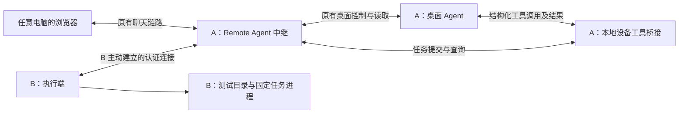
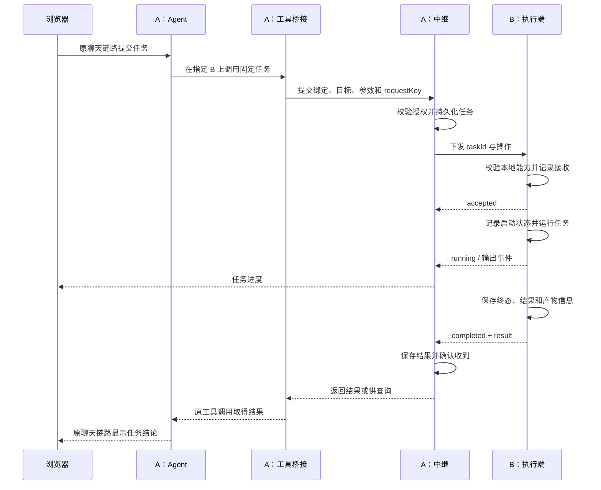

# 电脑之间的 Agent 执行闭环：设计与验证方案

日期：2026-10-21

状态：设计提案，尚未实现或实测。本文仅讨论电脑之间的协作，不涉及手机控制。

## 1. 要验证的目标

用户通过浏览器向电脑 A 上的 Agent 提出任务，Agent 调用电脑 B 的实际能力，B 执行后返回真实结果，Agent 在原会话解释结果，浏览器正常显示。

第一阶段需要证明以下链路完整成立：

> 浏览器提出任务 → A 上的 Agent 调用设备工具 → A 中继找到 B → B 本地执行 → 结果返回原工具调用 → Agent 生成回复 → 浏览器显示。

验证必须证明任务确实发生在 B，而不是 Agent 只生成了一段建议、在 A 上运行了同名命令，或中继仅收到一条“成功”消息。

本文不授权安装执行端、配对设备、运行远程命令或修改产品代码。实施前确认具体两台电脑、测试目录、试点 Agent 和本次范围，遵守 [用户要求与续做记录](development-requirements.md)。

## 2. 当前架构与缺失部分

当前产品的基本链路是浏览器向电脑中继发操作请求，中继通过桌面应用接口驱动 Agent，再把聊天和状态送回浏览器。

这套通信可以承载新增消息，但网页连接本身不赋予中继操作浏览器所在电脑的能力。

| 部分 | 现有基础可以承担什么 | 本方案需要新增什么 |
|---|---|---|
| 浏览器界面 | 提出任务、查看聊天和状态 | 选择执行电脑、显示设备任务进度与结果来源 |
| A 的中继 | 连接和认证机制、Agent 会话上下文 | 执行设备注册、任务路由、任务记录与结果查询 |
| A 上的 Agent | 理解目标、处理工具返回内容 | 可调用的设备工具入口 |
| B | 可以用浏览器访问 A | 在 B 本地运行的执行端及显式授权 |
| 结果回传 | 现有聊天显示链路 | 将执行结果交还原 Agent 工具调用，而不只是推给网页 |

以上表示可复用的职责，不保证现有接口可原样复用；实施时只检查涉及的接入点。

## 3. 角色与部署方式

### 3.1 三种角色

| 角色 | 职责 | 是否需要大模型 |
|---|---|---|
| 操作入口 | 浏览器，提交目标、查看过程、取消任务 | 否 |
| 调度电脑 A | 运行 Agent、中继和工具桥接组件，负责安排任务 | Agent 在这里工作 |
| 执行电脑 B | 运行执行端，提供经授权的本地能力 | 否 |

浏览器可以位于 A、B 或第三台电脑。B 打开浏览器访问 A，不等于 B 已成为执行设备；只有 B 的执行端注册上线后，才可以被选择为执行目标。

同一台 B 可以打开多个浏览器标签页，但它们不能被计为多个执行设备。Agent 会话、浏览器连接和执行设备分别标识。

### 3.2 首版部署选择

- A：保留当前中继与桌面 Agent，增加设备任务模块和一个本地工具入口。
- B：启动一个独立执行端进程；复用项目已有运行环境的方案优先，具体语言在实施时确定。
- B 不需要安装 A 所用的桌面 Agent，也不必复制 A 的聊天缓存或认证文件。
- B 主动连接 A；首轮在两台电脑可互通的局域网验证，随后再验证现有公网入口。
- 首轮手动启动执行端，不安装开机服务，不做多主机选举或集群。
- 首次只验证实际选定的两种操作系统组合，不因协议设计而宣称所有平台已经支持。



设备任务建议使用独立的连接路由和处理队列，避免长任务阻塞已有聊天、发送或终端操作。可以共用中继进程和公开地址，不必另建公网服务。

## 4. 本阶段做什么

### 4.1 最小能力集合

| 能力 | 用途 | 首版边界 |
|---|---|---|
| `device.info` | 返回执行端版本、平台、设备 ID、在线状态 | 不返回账户秘密、完整环境变量 |
| `fs.list` | 列出测试目录当前层的条目 | 指定根目录内，不递归扫描整机 |
| `fs.readText` | 读取测试文件或结果文件 | 指定根目录内，明确大小上限 |
| `job.run` | 执行 B 预先登记的测试任务 | 使用任务名称和参数，不接收任意 shell 字符串 |
| `task.get` | 查询状态、输出及结果 | 只能访问当前授权范围内的任务 |
| `task.cancel` | 请求停止测试任务 | 仅操作执行端启动的该任务 |

`device.list` 由 A 返回已配对执行设备及当前能力，不要求 B 扫描局域网。

### 4.2 本阶段不纳入

- 任意终端命令、管理员权限、远程安装软件。
- 桌面鼠标键盘控制、屏幕串流、浏览器自动操作。
- 全磁盘文件管理或大文件传输。
- B 上再启动一个 Agent，或 A/B 自动互相调度。
- 多台执行电脑并行处理同一任务、自动负载均衡。
- 改写现有 Agent 导航、模型菜单、会话创建、聊天提取和 Fusion 流程。

固定任务用于证明远程执行链路；任意命令与桌面操作需要另行确认范围。

## 5. 设备身份、配对与能力

### 5.1 身份分离

| 标识 | 含义 | 生命周期 |
|---|---|---|
| `controllerId` | A 中继身份 | A 的持久身份 |
| `executorId` | B 执行端身份 | 重连保持，显式重新注册才改变 |
| `connectionId` | B 当前连接 | 每次重连更新 |
| `bindingId` | Agent 工具入口与原会话的绑定 | 绑定期间有效 |
| `taskId` | A 分配的一次任务 | 执行及查询期间保持 |
| `requestKey` | 调用方用于重试同一次提交的标识 | 同一操作保持 |

设备名称只用于显示。两台电脑都叫“工作电脑”时，不能凭名字选择目标。

### 5.2 配对流程

1. 在 A 创建一次性执行设备配对邀请。
2. 在 B 本地启动执行端，输入 A 地址和邀请信息。
3. B 的用户确认连接的是哪台 A，并选择测试根目录和开放的能力。
4. 建立独立的执行设备凭据，B 保存身份，A 保存对应记录。
5. B 上报能力后，A 的设备列表显示 B 可以执行哪些操作。

配对方向明确为“允许 A 调用 B 的指定能力”。原有浏览器配对凭据不能自动成为执行设备凭据，原浏览器设备列表和退出逻辑也不应被改写。

浏览器可使用现有登录身份查看或管理设备，但是否可以发起具体设备操作，需要关联到本次明确授权。凭据留在工具桥接与执行端，不能通过聊天文本交给模型。

### 5.3 能力记录示例

以下是示意数据，不是已有接口：

```json
{
  "executorId": "exec-b-01",
  "name": "电脑 B",
  "platform": "linux",
  "protocolVersion": 1,
  "capabilities": ["device.info", "fs.list", "fs.readText", "job.run"],
  "roots": [{ "id": "lab", "label": "闭环测试目录" }],
  "jobs": ["generate-manifest", "wait-marker"],
  "maxConcurrentTasks": 1
}
```

A 调用时使用 `rootId` 与相对路径，由 B 映射为实际本地路径，不把 A 的路径直接当作 B 的路径。首版拒绝越界路径及符号链接跨出授权目录；这定义了文件接口的访问范围，并不代表任务进程获得了操作系统级沙箱隔离。

支持的能力与当前可用状态分开表达：B 离线不等于不支持文件读取。协议版本不匹配时说明原因，首版不设计多版本兼容层。

## 6. Agent 怎样真正调用 B

### 6.1 工具入口

首个试点选择能够调用本地工具的现有 Agent，通过 MCP 或本地命令行桥接接入。优先使用该 Agent 已有的工具机制，不从普通回复文字中猜测控制指令。

首版建议提供：

```text
device.list()
device.inspect(executorId)
device.readDirectory(executorId, rootId, path)
device.readText(executorId, rootId, path)
device.runJob(executorId, jobName, arguments, requestKey)
device.getTask(taskId)
device.cancelTask(taskId)
```

这些是逻辑接口，传输协议中的字段名可调整。工具桥接调用 A 的任务模块，不能绕过 A 直接使用另一个未经管理的远程入口。

### 6.2 会话绑定

执行前，工具桥接需要获得由 A 建立的会话绑定，至少关联：

- 当前用户授权。
- 当前 Agent 应用、窗口及会话。
- 允许操作的执行设备与能力。

不能让模型随意填一个 `threadId` 就把结果投递到那个会话。也不能把结果投递到“此刻网页显示的会话”，因为用户可能已经切换。

最小验证可只为一个独立测试会话提供工具配置或绑定凭据。若试点 Agent 无法提供可靠的独立绑定方式，先验证直接工具调用，再明确记录“会话闭环尚未完成”，不以聊天注入替代工具结果。

### 6.3 返回方式

- 快速读取可以直接返回结果，同时保留任务记录。
- 固定任务提交后返回 `taskId`，工具桥接可短暂等待；未结束时返回当前状态，Agent 继续查询。
- 浏览器断开不终止任务；工具调用超时不等于远端任务失败。
- 任务结果交还原工具调用或由原会话查询，Agent 据此生成回复。
- 浏览器进度事件用于展示，不作为 Agent 已拿到结果的证据。
- 发生会话关闭或工具进程退出时，结果留在任务记录中，不自动发送到其他会话。

## 7. 单次任务的完整时序



原聊天链路通过中继与桌面 Agent 完成，图中省略其内部细节。新增任务输出不经过现有桌面终端输入框，也不向用户正在工作的终端键入命令。

## 8. 消息和结果格式

### 8.1 任务下发示例

```json
{
  "type": "task.dispatch",
  "protocolVersion": 1,
  "taskId": "task-001",
  "executorId": "exec-b-01",
  "operation": "job.run",
  "arguments": {
    "jobName": "generate-manifest",
    "rootId": "lab",
    "runId": "trial-001"
  },
  "startBefore": "<UTC 时间>",
  "timeoutMs": 30000
}
```

会话和权限绑定由 A 保管；B 只收到执行所需字段。任务名称在 B 映射为固定程序及参数结构，不拼接用户输入生成 shell 命令。

### 8.2 任务结果示例

```json
{
  "type": "task.result",
  "taskId": "task-001",
  "executorId": "exec-b-01",
  "seq": 4,
  "state": "succeeded",
  "exitCode": 0,
  "result": {
    "runId": "trial-001",
    "fileCount": 3
  },
  "artifacts": [
    {
      "rootId": "lab",
      "path": "runs/trial-001/manifest.json",
      "sha256": "<文件摘要>"
    }
  ]
}
```

`exitCode: 0` 只是进程成功退出；闭环验证还需要核对结果内容和产物。失败时提供明确错误码和简短原因，不用一条笼统的“连接失败”覆盖所有阶段。

建议错误类别：设备离线、未授权、能力不支持、路径不合法、任务启动失败、进程非零退出、执行超时、取消未确认、执行结果未知。

## 9. 任务状态、断线和重复提交

### 9.1 状态定义

| 状态 | 含义 |
|---|---|
| `created` | A 已记录任务，B 尚未确认接收 |
| `accepted` | B 已记录接收，尚未启动 |
| `running` | B 已启动任务 |
| `succeeded` | B 已确认完成并保存成功结果 |
| `failed` | 已知执行失败，具有原因 |
| `cancelled` | 已确认未启动或已停止 |
| `expired` | 超过允许开始时间，并确认未开始 |
| `unknown` | 无法确认是否执行或是否完成，等待核对 |

“设备离线”和“取消请求已发送”单独显示，不直接覆盖任务执行状态。已运行任务不能仅因截止时间到了就被标记为未执行。

### 9.2 最小持久化与去重

- A 保存目标、请求指纹、会话绑定、状态和最终结果。
- B 保存收到的任务 ID、请求指纹、启动状态及终态结果。
- 同一调用方作用域中的相同 `requestKey` 和相同参数返回原 `taskId`；参数变化却复用同一 key 时拒绝。
- B 重复收到同一 `taskId` 时返回记录，不重新启动；同一 ID 对应不同内容时拒绝。
- 结果事件携带序号；重复结果允许再次确认，旧事件不能覆盖终态。
- A 确认持久化结果后向 B 回执；B 重连可补传未获确认的结果。

这降低传输重试造成重复执行的风险，不承诺任意外部操作都能严格“恰好执行一次”。例如 B 在写入文件后、保存成功记录前崩溃，只能先核对产物，不能自动重跑。

### 9.3 断线约定

| 场景 | 首版行为 |
|---|---|
| 提交时 B 已离线 | 明确返回离线，不排队等它数小时后自动执行 |
| 下发后未收到确认即断线 | 保留原任务 ID，重连查询；不能断言从未执行 |
| B 执行中失去网络 | 有限时的测试任务继续运行并本地保存结果，恢复后补传 |
| A 中继重启 | 从任务记录恢复，等 B 重连后核对，不重新执行 |
| B 执行端崩溃 | 对未终结任务标记结果待核对，不盲目启动第二份进程 |
| 浏览器关闭或切换会话 | 任务继续，结果保持原归属，可在任务记录查询 |

首版不因重连自动重试有副作用的任务。确认需要重试时创建新任务，并关联原任务供追踪。

### 9.4 并发、取消和输出

- B 同时运行一个固定任务；忙碌时新执行请求返回忙碌，不积压隐式队列。
- 状态查询和取消请求不被正在执行的任务阻塞。
- 取消只针对执行端创建的该任务及可确认的子进程；具体平台的停止实现必须实际验证。
- “取消成功”意味着已经确认停止，不能仅以取消请求发送成功判断。
- 固定任务初始限制可采用30秒超时、64 KiB累计文本输出及64 KiB文本文件读取上限；数值属于待确认默认值。
- 输出到达上限时继续排空子进程管道，仅截断保留内容并标记截断，不能让子进程因管道堵塞无法结束。
- 大产物留在 B，首版只传元数据和小文件；不经聊天消息携带完整大文件。

## 10. 闭环验证环境

### 10.1 最小准备清单

- [ ] 明确 A 和 B 的实际操作系统与运行环境。
- [ ] 选择一个能够接入设备工具的 Agent，创建独立测试会话。
- [ ] A、B 网络可达，使用现有 HTTPS/WSS 入口或局域网测试入口。
- [ ] B 创建专用测试根目录，确认没有真实工作数据。
- [ ] B 仅开放本方案最小能力和固定任务。
- [ ] 保存本次新增执行设备 ID，测试后只撤销这一条记录。

建议目录结构：

```text
<B 的专用测试目录>/
  inputs/
    alpha.txt
    beta.txt
    中文.txt
  runs/
```

三个输入文件使用事先约定的内容。预期文件数、字节数和摘要在 B 本地独立计算并记录，不能只用 Agent 自己的解释作为判断依据。

A 的协议记录和截图放 `_shots/computer-loop/<runId>/`。B 的测试产物放指定测试目录；不收集真实文件正文或凭据进入测试日志。

### 10.2 必须区分的验证层级

| 层级 | 可以证明什么 | 不能代替什么 |
|---|---|---|
| 受控测试 | 路由、状态转换、重复事件处理等逻辑 | 两台真实电脑的通信与执行 |
| A 工具直接调用 B | 工具桥接、中继、执行端链路成立 | Agent 能正确调用并使用结果 |
| 浏览器发起完整任务 | 用户入口到远端执行再回到原会话的闭环成立 | 全平台、全部 Agent 或公网稳定性 |

最终闭环必须完成第三层，不能把前两层结果写成全链路成功。

## 11. 验证一：只读目录闭环

### 11.1 用户任务示例

> 在电脑 B 的“闭环测试目录”中查看 inputs 当前层的普通文件，列出名称和字节数并统计数量；不要修改文件。

### 11.2 实际步骤

1. B 启动执行端并主动连接 A，确认 A 设备列表里只出现一个 B。
2. 浏览器打开 A 的独立测试会话，选择 B 为本任务目标。
3. 用户发送上述任务。
4. Agent 调用设备列表或设备详情，明确选择 B 的 `executorId`。
5. Agent 调用目录读取工具，参数为 `rootId=lab`、`path=inputs`。
6. A 校验会话绑定和设备授权，生成任务记录并发往 B。
7. B 读取实际目录，返回结构化条目。
8. 工具桥接将结果交回该 Agent，Agent 在原会话给出清单和数量。
9. 浏览器显示来源是 B；对照 B 本地独立记录核对结果。

### 11.3 通过标准

- B 的执行记录含对应任务 ID，执行目标为指定根目录。
- 三个文件的名称、字节数和数量与本地记录一致。
- B 的输入文件未变化，A 未在本地代替 B 读取数据。
- 工具结果确实进入 Agent 上下文，最终回复来自真实结果。
- 用户可以定位到此次设备任务及执行来源。

## 12. 验证二：固定任务执行与产物回读

### 12.1 测试任务定义

在 B 登记 `generate-manifest`，任务行为固定：

1. 读取 `inputs/` 当前层三个普通文件。
2. 统计名称、字节数、SHA-256摘要及总字节数，按名称稳定排序。
3. 在新的 `runs/<runId>/manifest.json` 写出结果，包含 `runId` 和 `taskId`。
4. 输出简短摘要并正常退出。

产物目录按本次运行独立创建，不覆盖既有结果。固定任务通过程序参数调用，不借用 B 桌面上正在工作的终端。

### 12.2 用户任务示例

> 在电脑 B 运行已登记的 generate-manifest，使用运行编号 trial-001。完成后重新读取结果文件，告诉我文件数量、总字节数和产物位置。

### 12.3 实际步骤

1. Agent 提交固定任务，A 返回 `taskId`。
2. B 接收并执行，网页显示接收、运行和完成状态。
3. Agent 经原工具调用或任务查询获得终态、退出码与产物路径。
4. Agent 再调用 `fs.readText`，从 B 重新读取该产物。
5. Agent 比较执行摘要与回读内容，再生成最终答复。
6. 在 B 本地核对实际产物、输入摘要和任务进程执行记录。

### 12.4 通过标准

- 执行确实发生在 B，退出码为0。
- 产物位于 B 的约定目录，文件内容符合独立计算的预期。
- 回读内容与执行结果一致，任务编号对应。
- A 上没有生成冒充 B 产物的同名文件。
- 全程未改动真实项目、桌面会话、模型或用户终端。

## 13. 一次必要的异常验证

每种情况验证一次即可；只有失败或后续修改影响该路径时才复测。

| 情况 | 操作 | 预期结果 |
|---|---|---|
| B 离线 | 停止测试执行端后提交 | 返回离线；重新上线不突然执行旧请求 |
| 能力未开放 | 请求未登记任务 | 明确拒绝，B 未启动进程 |
| 路径越界 | 读取测试根目录外路径 | 拒绝且不读取文件 |
| 重复提交 | 使用相同 key 和参数提交两次 | 同一 taskId，任务只启动一次 |
| 重复下发 | 向 B 重发同一任务 | 返回既有状态或结果，不再启动 |
| 执行中断网 | 使用有限时 wait-marker，短暂断开 B 的任务连接 | B 完成并留存，重连补回结果，无重复执行 |
| 中继重启 | 测试任务运行期间重启 A 的测试中继 | 任务记录恢复，B 重连核对；不把失联显示成成功 |
| B 执行端崩溃 | 在独立测试任务中停止执行端 | 非终态任务进入待核对，不自动重跑 |
| 取消 | 运行 wait-marker 后请求取消 | 确认停止才显示取消，完成标记不被迟到写入 |
| 浏览器切会话 | 执行期间切到另一个测试会话 | 结果仍归原会话，不污染新会话 |

`wait-marker` 是仅用于验证的固定任务：等待有限时间后写入本次运行的完成标记。断网只中断任务连接，避免修改整机网络影响其他工作。

中继重启、执行端崩溃测试优先使用独立测试实例；没有隔离环境时记录未测项，不中断生产 Fusion 或现有真实任务。

## 14. 页面呈现与操作体验

首版沿现有界面增加最少信息：

- 单独的“执行电脑”选择入口，与“连接哪台中继电脑”和“选择哪个 Agent”区分。
- 目标设备显示名称、在线状态与简短身份，避免误选同名电脑。
- 任务卡片显示执行电脑、操作摘要、状态、结果和必要的取消入口。
- Agent 回复可以引用任务产物；正文不混入底层通信日志。

任务提交时固定目标。用户后来切换“执行电脑”只影响新任务，不改变正在执行的任务，也不自动切换聊天所属项目。

可用体验示例：

```text
对话：A / 当前 Agent / 测试会话
执行电脑：B

任务：生成文件清单
电脑 B · 执行中

任务：生成文件清单
电脑 B · 已完成
3 个文件 · 结果：runs/trial-001/manifest.json
```

任务卡片完成和 Agent 最终回复是不同事件：前者表示 B 已完成，后者表示 Agent 已取得并解释结果。

## 15. 与现有适配工作的关系

本设计与 [Agent 接入改进计划](agent-adapter-plan.md)职责不同：

- Agent 适配负责让中继对接不同桌面 Agent。
- 设备执行接口负责让 Agent 使用不同电脑的能力。
- 设备工具桥接负责将两者连接，并保持任务与会话归属。

概念验证只选一个 Agent，不要求等待所有 Agent 适配完成，也不顺手扩大现有迁移范围。能力声明思想可以复用，但 Agent 能力和执行设备能力分别管理，避免混在同一列表。

实施时沿用现有认证、序列化、日志和界面组件中适合复用的部分；新增执行设备状态不要污染现有桌面窗口列表、项目列表或浏览器配对存储。

## 16. 建议实施顺序与阶段交付

| 阶段 | 内容 | 交付与停止条件 |
|---|---|---|
| P0：确认环境 | 明确 A/B、系统、Agent、目录、可执行任务 | 具体方案获得确认，不安装或执行 |
| P1：设备通道 | B 主动连接、独立配对、身份与能力上报 | 重连身份稳定，可查询在线设备 |
| P2：只读工具 | 目录读取、会话绑定、工具结果返回 | 验证一完整通过 |
| P3：固定任务 | 子进程执行、产物回读、任务持久化 | 验证二完整通过 |
| P4：必要异常 | 去重、断线、取消、结果归属 | 第13节逐项记录通过或未验证 |
| P5：公网验证 | 复用中继公开入口，两电脑跨网络 | 在新 runId 上执行一次固定任务，结果核对一致 |

每阶段完成后记录实测结果，再决定下一阶段，不以“连接成功”代替完整验收。

建议第一批实现只到 P2；P2 验证了原 Agent 可以使用 B 的真实数据，再投入远程进程执行和异常处理。

## 17. 最终验收清单

- [ ] 浏览器发出的自然语言任务实际触发了设备工具调用。
- [ ] B 使用稳定身份连接，浏览器标签页不被识别为多个执行设备。
- [ ] B 的授权能力和测试范围生效，原浏览器配对保持。
- [ ] 只读目录闭环通过。
- [ ] 固定任务执行、产物回读与本地核对通过。
- [ ] 重复请求不会重复启动同一个任务；不确定结果明确呈现。
- [ ] 任务状态与会话归属在断线、重连和切换后保持正确。
- [ ] 正常聊天、会话导航、终端、模型和已有优化未被本次改动影响。
- [ ] 协议变更运行项目必需检查，其他测试按实际影响范围执行。
- [ ] 记录实际设备、系统、耗时、任务 ID 和未验证事项，不把局域网结果作为公网保证。
- [ ] 清理仅限本次测试设备、进程和产物，保留其他授权与用户数据。

## 18. 下一步要确认的具体事项

1. 哪台电脑作为 A，哪台作为 B，各自操作系统是什么。
2. 首个试点 Agent 及其可用的工具接入方式。
3. B 的独立测试目录与允许的最小能力。
4. 第一批仅做到 P2，还是确认继续做到 P4。

完成这些确认后，才能给出针对现有代码的最小实现清单。本文本次交付仅为文档，不安装服务、不修改代码、不执行远程任务、不发布或重启。
