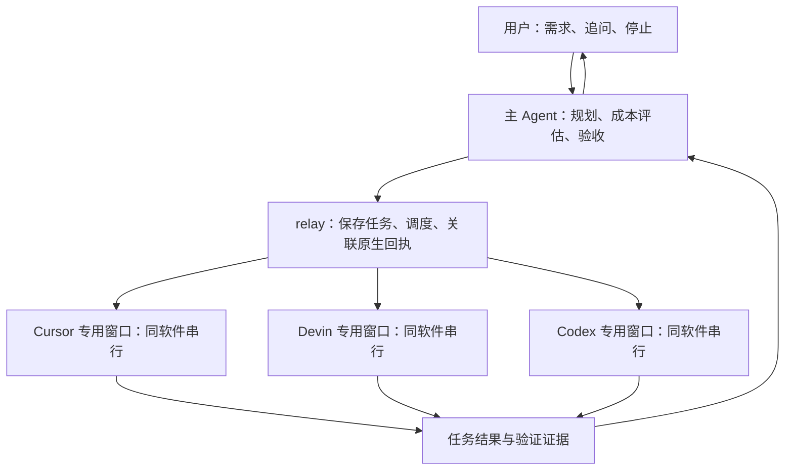

# Fusion 主 Agent 与多子 Agent 全量重写方案

> 日期：2026-11-01。状态：按用户最新要求修订，允许完整移除旧 RA Fusion，仅设计新版实现；产品代码尚未实施。
> 本轮执行范围：更新主页底部 Fusion 入口设计及跨电脑续做 prompt。本轮不修改产品代码、真实历史数据或窗口。实施前按 [AGENTS.md](../AGENTS.md) 确认具体代码批次；工作方法见 [排查、修改与验证流程](../skill/remote-agent-workflow/SKILL.md)，续做指令见 [Fusion 改造 prompt](fusion-rewrite-prompt-20261101.md)。
> 已有基准记录：上一轮只读核对时，本地与实际 GitHub 远端 `master` 同为 `20e9e8f31440553396b20cf2f7f87b825f7a9294`，标准检查 222 项通过。当前工作区还有其他原生适配改动，实施时须重新以当时工作区建立基准，不把上一轮检查当作最新结果。

本次修订取代原方案中的“兼顾旧 A/B 流程、整理旧历史、续接旧 run”要求。新版只有一个执行引擎、一套状态和一套手机协议，不增加版本兼容、旧协议别名、双引擎开关或旧历史转换器。

## 1. 已确定的产品行为

Fusion 从主页底部导航进入，与“概览／项目／收藏”同级，顺序为 **概览｜项目｜收藏｜Fusion**。顶部 Agent 选择菜单和横屏 Agent 列表移除 RA Fusion 入口；三个原生软件及 Devin 原生 Fusion 模型模式保持各自职责。

用户选择项目、主 Agent 所属软件、主 Agent 的模型与思考强度，以及“省钱／均衡／性能”档位。此后只与主 Agent 对话，不再配置 A／B 两个角色，也不手选子 Agent 的模型。

主 Agent 根据任务决定自己完成，或创建 B1…Bn 子任务，选择每个子任务的软件、模型和思考强度。子任务回传结果后，由主 Agent 验收、继续派工、自己补做或向用户交付。子任务可以分批创建，无固定总数，也无固定评审轮数；简单任务允许零子 Agent。

以下要求是实现约束：

- 结束依据是用户要求和实际完成证据。删除现有“最多 4 轮”的任务结束规则；不能把超时、失联或额度不足写成完成。
- 档位表达成本、速度、质量的取舍，不设模型名单、模型等级门槛或思考强度上限。省钱档允许使用更贵但预计总花销更低的模型，性能档也允许简单任务使用便宜模型。
- 同一电脑、软件、项目最多一个 **Fusion 专用窗口**，主 Agent 与该软件的全部子任务共同使用。用户原有的普通窗口不计入这个数量，也不被借用、切会话、改模型、清草稿或关闭。
- 首版每个软件同时执行一个 Fusion 原生任务，多个子任务排队；不同软件可以并行。该限制是桌面资源和并发约束，与成本档位无关。
- 收藏会话对应的同软件／同项目窗口不得自动回收，归档后的收藏同样有效；复用此前已修复的收藏归属和窗口回收逻辑。
- 沿用用户授权及项目 `AGENTS.md`。需要确认方案的项目先由主 Agent 给出方案，确认后在原范围内执行；不要求用户逐个批准子 Agent 的常规分工。原生权限审批保持原义。
- 正常 Cursor／Devin／Codex 会话、原生 Devin Fusion 模型模式与 RA Fusion 编排分别保持原有职责。

## 2. 参考与 RA 的实现边界

参考 DeepSeek 官方仓库中的 [Super-agent 研究原型](https://github.com/deepseek-ai/dsh-superagent-prototype)。其 README 明确区分研究原型与正式产品，也说明文章中的部分方向尚未实现；本方案不把概念描述当作现成可接入能力。

借鉴的是主会话接收需求、独立工作任务保存执行状态、结果回传、执行槽位与任务生命周期分离。原型的 [执行文档](https://github.com/deepseek-ai/dsh-superagent-prototype/blob/main/docs/003-execution.md) 描述了任务自己的会话、目录及 worker slot；[架构文档](https://github.com/deepseek-ai/dsh-superagent-prototype/blob/main/docs/007-architecture.md) 描述了状态与外部执行的分工。

以下是 RA 自己的设计：继续使用现有 CDP、原生会话、模型菜单和回执，不引入 DeepSeek Harness 运行时，不假定三个桌面软件支持临时无痕 Agent。逻辑子 Agent 完成后可以释放执行资源，但原生会话仍需按软件支持的动作归档或保留。首版不增加 CLI／API 执行通道，也不自动监听 GitHub、主动找任务、提交或推送。

## 3. 删除旧实现，明确复用边界

| 位置 | 删除内容 | 新版职责 |
|---|---|---|
| `server/fusion/state.mjs` | `a/b`、`round/miss`、旧固定阶段和单份计划／结果／评审、`fusionMark()`、启动时把活动 run 改成 idle 的逻辑 | 新 Run／Task／Attempt／Binding、事件、验收证据和恢复状态 |
| `server/fusion/owner.mjs` | A 规划→B 执行→A 评审、小修／退回、4 轮结束、旧 side 列表和续接方法 | 重写为手机入口、配置、状态与历史输出；执行决策归 Runner |
| 同文件原生执行代码 | 借用普通项目窗口、Devin 任取窗口后切项目、全局 `fusionAccess`、单份 `fusionConnection/fusionSideLive` 及批量继承 owner 状态 | 原生能力放在 `agent.mjs`，按明确 Binding／Attempt 创建上下文；由软件槽位管理 |
| `server/routes.mjs`、`server/agent/menus.mjs` | 旧 A/B 选取、旧角色模型菜单、`fusionGo/fusionDecide` 等入口和转发 | 新配置、主对话、方案确认、任务详情和原生操作协议 |
| `server/project-windows.mjs`、`server/agent/session-actions.mjs`、`server/apps/codex.mjs` | 固定检查 `a/b` 的占用与移除引用 | 查询新版实际绑定和执行事实，不复制另一套归属表 |
| `server/overview.mjs`、`app/js/overview.js` | 主页快照与卡片中的旧 A/B、轮数、阶段枚举及唯一依靠 Fusion 伪项目进入的路径 | 主页底部第四项 Fusion、电脑与新版 run 归属、运行摘要及返回导航 |
| `server/windows.mjs`、手机端 Fusion 分支 | 把 RA Fusion 作为普通软件列在顶部／横屏 Agent 选择区；A/B 配置、角色额度、固定阶段／轮数、完成／小修／退回按钮、旧专用文案及缓存变量 | 原生软件列表与 Fusion 工作区入口分开；主 Agent 配置、三档偏好、主对话、任务面板及新历史 |
| 旧 Fusion 持久化 | 旧 `fusionHistory` 数据及其读取／写入代码 | 一次性切换时清理旧键；新版只读写 `fusionRuns`，不迁移或续跑旧记录 |

按实际职责和调用链删除，不能全仓按“Fusion”字样清理。以下能力继续复用：

- `AgentContext`、CDP、原生会话创建／切换、模型与强度、发送接受／完成依据、权限确认、差异和用量读取。
- 电脑端 Runner 与手机 viewer 分离的归属关系，窗口租约、焦点租约、收藏库及既有空闲扫描器。
- 被普通 Agent 使用的项目身份和会话项目映射，包括 `fusionProject()`、`conversationProjects` 等现有共享能力；不因其位于旧 Fusion 文件中而误删或搬迁无关实现。
- Devin 原生 Fusion 模型模式及其 `fusionConfig/fusionOptions/fusionPick` 等能力。它不属于本次删除的 RA A/B 编排。

旧 Fusion 记录不要求在新版中可见或继续；三个软件的原生历史、收藏、普通窗口及其他 relay 状态均不属于旧 Fusion 元数据清理范围。

现有窗口／会话修复的证据见 [统一检查记录](../_shots/session-window-repair-20261101/verification.json)：222 项行为测试通过，三个软件各一个测试窗口已回收，六个原有窗口的会话、模型、草稿未变。该记录属于前一轮修复，不是新 Fusion 的验收结果。

## 4. 对象与职责



| 对象 | 最小必要内容 | 生命周期 |
|---|---|---|
| Fusion 会话／run | `id`、设备归属、项目、主 Agent、档位、用户要求及授权范围、完成标准、任务和历史 | 从新版创建开始保存；一轮交付后允许用户继续提出要求 |
| 逻辑任务 Task | `id`、目标、依赖、允许修改范围、验收条件、状态、主 Agent 验收结果 | 创建→排队→执行→待评审→接受／继续／失败／取消 |
| 执行记录 Attempt | Task ID、软件／模型／强度、成本预估及理由、原生会话／轮次 ID、提交状态、结果／差异／验证 | 同一任务更换模型或重新执行时新增记录，不覆盖此前事实 |
| 原生会话 Binding | 软件、host、原生 thread ID、项目、所属任务或主 Agent、归档状态 | 主 Agent 独立会话；每个独立子任务独立会话，同任务继续可复用 |
| 专用窗口 | `computer + app + host + canonical project root`、明确的 Fusion 用途、实际 target ID | 按需打开；窗口关闭不删除任务和历史 |
| 执行槽位 Slot | 所属软件、当前任务、窗口租约、连接与原生执行状态 | 提交至确认原生结束期间占用；不是常驻模型请求 |

窗口登记归 `project-windows.mjs`，收藏归 `session-library.mjs`，任务事实归 Fusion state。Fusion 只引用窗口与收藏状态，不复制一套收藏表或关闭策略。所有 ID 都区分电脑、软件、host 和项目；窗口标题不是身份依据。

新版沿用现有 `readState/saveState` 持久化设施，使用 `fusionRuns` 保存按设备归属的当前 run 和 run 集合。Run 至少保存主会话消息、待处理事件、授权范围、完成标准、任务、Attempt、Binding 和已消费的决策身份。原生连接、监听、软件槽位及正在创建的窗口 Promise 属于进程内执行资源，不当作可恢复的连接序列化。

模块分工固定为：`state.mjs` 保存事实，`control.mjs` 定义主 Agent 输入与决策协议，`runner.mjs` 顺序应用事件和决策，`scheduler.mjs` 分配资源，`agent.mjs` 执行原生动作，`cost.mjs` 整理成本事实，`owner.mjs` 为手机提供入口和展示。不要把旧阶段流程搬进新的模块名。

## 5. 主 Agent 如何真正控制编排

桌面 Agent 没有统一的外部工具调用接口，首版使用 **原生对话 + 结构化决策回执**：relay 给主 Agent 发送本轮需求、任务状态、可用能力和成本资料；主 Agent 在完成回复末尾输出一个约定的 `fusion-control` JSON 块。普通说明仍作为用户可见的回复，控制块由 relay 消费。

Runner 为本次决策请求生成 `decisionId`，向主 Agent 提供所属 `runId`、本次事件、已确认范围、任务状态及能力／成本资料。主 Agent 回传同一身份及有序的 `actions`；派工时必须包含软件／模型／强度、输入、修改范围、验收条件及成本评估。协议和提示词集中在 `control.mjs`，不把解析分散在三个软件适配器中。

| 动作 | 实际含义 |
|---|---|
| `plan` | 建立／调整完成标准与任务依赖；需要方案确认时向用户展示 |
| `dispatch` | 对已获授权且依赖满足的任务分配原生执行；同软件排队 |
| `continue_task` | 向同一任务补充要求，或明确更换执行配置并保留上一条 Attempt |
| `review` | 按任务验收条件接受结果，或指出未完成项并交回继续；保存对应证据 |
| `self_execute` | 主 Agent 使用用户选定模型和强度执行有范围及验收条件的任务，同样占槽并产生 Attempt；简单任务无需创建子 Agent |
| `wait` | 等待正在运行的任务或外部结果，不产生空转模型调用 |
| `ask_user` | 提出缺失信息、范围变更或真实阻塞，主对话保持统一入口 |
| `cancel_task` | 取消尚未开始的任务，或对正在执行的目标请求停止并等待原生确认 |
| `finish` | 主 Agent 给出完成标准逐项结果及最终交付，进入完成条件核对 |

relay 只从本次主 Agent 原生轮次的已完成回复读取决策，不执行子任务文本、历史回复或思考片段里的控制块。以原生轮次和 `decisionId` 关联一次执行；解析失败显示具体原因并等待主 Agent 纠正，不猜测动作、不把旧标记当新指令。

用户新消息与子任务结果进入 run 的待处理事件。主 Agent 一次只处理一个决策轮次；当前轮结束后把已到结果一起提交，避免每个片段都唤醒一次主 Agent。用户停止由 relay 直接处理，不等待主 Agent 获得执行槽位。

一个派工回执的最小形态如下，字段值均为示意，模型必须来自本轮实际候选：

````text
先完成目录读取排查，再根据结果决定是否需要修改。
```fusion-control
{
  "runId": "本次 run ID",
  "decisionId": "Runner 提供的本轮 ID",
  "actions": [{
    "type": "dispatch",
    "reason": "该项可独立只读核查，避免重复占用主会话上下文",
    "task": {
      "id": "B1",
      "goal": "确认目录读取结果与原生会话归属",
      "dependsOn": [],
      "access": "read",
      "scope": ["server/fusion/agent.mjs"],
      "acceptance": ["提供请求、会话身份及读取结果的对应证据"]
    },
    "execution": {
      "app": "codex",
      "model": "本轮实际模型标签",
      "effort": "该模型实际支持的强度",
      "input": "只读取允许范围，返回事实与证据，不修改文件或递归创建子 Agent"
    },
    "cost": {
      "estimate": "金额未知；根据任务规模作相对成本估计",
      "source": "本轮候选资料及其读取时间",
      "alternatives": "与主 Agent 自己执行比较的理由"
    }
  }]
}
```
````

`plan` 负责建立范围、完成标准与依赖；需要用户确认时进入 `awaiting_user`。确认消息关联具体计划与范围，后续分工复用该授权；范围变化再询问用户。主 Agent 的决策轮只做规划／评审，实际工作通过 `dispatch/self_execute` 记录；`review` 为接受或退回附上证据，`finish` 逐项引用完成标准及证据。

同一回执的动作按顺序应用，派工只执行依赖已满足且在授权内的任务。解析或业务字段错误要展示具体原因并记录待处理事项，不能猜动作或反复自动请求模型修复。无事件的 `wait` 不启动下一轮主 Agent 调用。

## 6. 档位、模型和花销

三档定为：

| 档位 | 给主 Agent 的取舍要求 | 不能推导出的限制 |
|---|---|---|
| 省钱 | 满足验收条件前提下，尽量降低预计总花销，减少无价值拆分与返工 | 不能限定只能低价模型／低强度 |
| 均衡（默认） | 同时评估花销、预计完成时间与返工风险 | 不能固定“中档模型” |
| 性能 | 优先完成质量与时间，但仍说明额外开销是否值得 | 不能固定最高价／最高强度或最大并发 |

每次派工前执行同一条链路：

1. relay 提供候选软件当前实际可选模型、强度、任务能力、原生价格／额度资料及读取时间。复用原生菜单和账户读取；只在专用窗口内进行会改变 UI 的读取，普通窗口只允许现有不改状态的读取。
2. 主 Agent 评估任务大小、需要的上下文、工具与验证工作、预计执行时间和返工成本，比较自己执行与委派的总花销。至少说明选定组合相对可用替代方案的理由；只有一个候选时明确这一事实。
3. 保存选择依据和估算后再提交子任务。子任务数、模型与强度由该次评估决定，代码不按档位写固定映射、分值权重或价格阈值。
4. 结果回传时记录实际可读取用量、耗时、是否返工；后续派工使用这些已观测事实重新评估。调度只在任务边界切换配置，不在生成中途改模型。

预计总花销包含主 Agent 的规划／评审、子任务推理与工具工作，以及预计补做开销。主 Agent 模型始终由用户选择，relay 不因档位自动替换它；主 Agent 成本无法获得时也明确标未知。

价格资料必须带来源和口径：原生明确金额才记录金额；只有倍率、套餐额度或 Free 时保留原单位，不能套用其他产品 API 单价换算订阅桌面账单。Cursor Auto 作为原生 Auto 选项，不猜其内部实际模型。没有数据时标记“金额未知／相对成本估计”，不得写成免费或精确金额；免费也不意味着无限并发或没有额度限制。

用户可以额外指定总预算或时间要求，但不是默认必填项。只有用户明确设置的预算才形成预算边界；费用信息不足以严格核对金额预算时，主 Agent 说明限制并请求决定，不能声称已保证不超支。普通档位不自动增加逐项批准流程。

## 7. 窗口共享、并发与文件修改

### 7.1 专用窗口获取

按照窗口键查找 **已登记为 Fusion 用途** 的存活窗口；没有才打开一个，并在原生项目身份就绪后登记。仅有 `owned=true` 不足以认定它属于 Fusion，因为普通 RA 新建窗口也可能是 owned。两个入口同时申请相同窗口时复用同一次创建结果，不各自打开。

同项目的正常窗口即使空闲也不自动转成 Fusion 窗口。不能延续当前“匹配项目就借用窗口”或 Devin 任取一个窗口再切项目的路径。远程项目同样按 host 区分；原生通道不能创建／连接专用目标时明确标为不可调度，不借普通远程窗口代替。

主 Agent 与子 Agent 使用相同软件时，在同一个专用窗口切换各自的原生会话：主 Agent 决策结束先释放软件槽位，子任务才能开始；子任务生成期间不切走到主会话。需要主 Agent 处理结果时在当前原生任务结束后调度，不形成“主 Agent 占着槽位等子 Agent”的互等。

### 7.2 执行与文件归属

- 首版 relay 内每种软件一个 Fusion 执行槽位，跨项目也排队；三个软件都可用时最多三个原生执行同时进行。不要通过多开窗口绕过这个限制。
- 原生切换、设模型、填输入、发送组成同一槽位内的顺序操作；持续观察至原生任务结束。复用已有焦点租约处理需要真实焦点的短操作，不整轮占住电脑焦点。
- 同项目一次只安排一个会修改工作区的任务，主 Agent 自己修改也遵守此规则。不同软件的独立只读分析可并行；依赖变更结果的读取／验证等待写任务结束。
- 首版共享用户选定工作区，不自动创建 worktree、不自动合并。记录开始时已有改动，评审比较本任务前后结果，不能把用户原有改动当作子任务成果。只读／写入分类是调度约定，不宣称构成原生 Agent 的文件系统隔离。
- 子 Agent 需要额外分工时向主 Agent 提议，首版不递归创建 RA 子 Agent，也不通过提示词主动启动软件内部的多 Agent 扇出。平台自身自动行为如不可控制，须记录实际能力边界。

调度按以下顺序实现，不另造通用工作流框架：

1. Runner 收集本次尚未处理的用户消息、任务结果、权限或原生错误，为主 Agent 建立一次决策请求。
2. 主 Agent 获取其软件槽位，完成本轮原生回复后立即释放该槽位；随后 Runner 顺序保存并应用决策。
3. 调度器从依赖满足的队列中选可用软件；写任务同时取得项目写占用。模型／菜单读取及原生准备操作也走所属软件槽位，避免与正在生成的会话互相切换。
4. `agent.mjs` 根据 Binding 获取专用窗口，创建或打开正确会话，设置本次配置并发送。主 Agent 自己执行也走同一资源路径，模型保持用户选择。
5. 不同软件可同时观察原生执行，执行结果作为事件交回各自 Runner。Run 的状态写入仍串行，不通过共享的“当前执行角色”接收所有结果。
6. 原生结束后保存结果及可读用量，释放本次执行资源，Task 进入待评审；由主 Agent 决定继续、接受或交付。

主 Agent 不持有软件槽位等待子任务，也不在持槽期间再排一个同软件操作并等待它。任务完成、依赖变化和新消息触发调度；不添加空转轮询主 Agent 的定时器。

## 8. 回收分为三个独立动作

| 层次 | 何时处理 | 保留什么 |
|---|---|---|
| 执行资源 | 原生任务结束、停止确认或确认未提交后，关闭本次连接／监听并释放槽位与租约 | Task、Attempt、原生会话 ID、结果与用量 |
| 原生子会话 | 主 Agent 接受结果且无待继续事项后，通过已支持的原生归档动作整理；失败／结果未知先保留 | 收藏、原生历史和 Fusion 中可追溯的任务结果 |
| 专用窗口 | run 无待执行资源后，交回现有空闲扫描器，满足原有回收条件才关闭精确 target | Fusion 历史、会话记录；关闭窗口不等于删除会话 |

没有原生归档能力就显示“会话保留”，不能把删除或清空伪装为归档，也不把列表隐藏当作回收成功。主 Agent 的原生会话在 run 可继续期间保留，不因一个子任务结束而归档。

窗口回收继续遵守：普通窗口不回收；手动保留、正在使用、真实前台焦点、未结束原生任务或项目命令阻止回收；收藏按同软件／同项目判断，归档收藏仍阻止回收。关闭前再读现有归属／使用条件，覆盖扫描期间新增收藏的情况；关闭失败记录原因，不能自动设为永久保留。复用既有实现，不新设定时器或第二套扫描流程。

用户在专用窗口中手动切换到无关会话或留下草稿时，记录当前归属变化／阻塞并交主 Agent 说明，不能强行切回、清空、停止或归档这个无关会话。原生后台命令仍运行时不能仅凭最终文字释放窗口。

## 9. 完成、停止与恢复

run 的最小状态为 `idle / planning / awaiting_user / running / reviewing / recovering / stopping / completed / blocked / stopped`。Task 分开记录 `queued / running / awaiting_review / accepted / blocked / failed / cancelled`；Attempt 另记提交前、已提交、原生运行／结束和结果未知，避免将“模型回答了”与“任务验收通过”混成一个状态。

`finish` 由主 Agent 提出。relay 核对所有必需完成标准均已由主 Agent 判定满足并关联证据，没有未处理的必需任务，没有原生执行、提交结果或停止结果尚未确认。主 Agent 可说明某子任务已被替代／取消，但不能静默取消未完成要求来宣称成功。验证内容是否满足需求由主 Agent 评审；relay 不用固定轮数或模型文案关键词替代评审。

用户停止时先停止新派工，取消尚未提交的队列，再只对本 run 仍在执行的原生目标请求停止；确认后进入 stopped。无法确认的目标保持 stopping／结果待核对，不能先提示全部停止。手机退出、切页、断线不等于停止。

新版状态持久化记录关键决策、提交身份和原生回执，不另造通用消息总线或数据库。Attempt 分开记录准备、提交中、原生已接受、运行、已结束、结果未知及停止待确认。发送前保存所属任务、Binding、本次输入和原生基准，接受后保存 thread／轮次身份；点击成功不能替代接受回执。每个 run 的状态变更由 Runner 顺序写入，不同软件的原生执行可以同时观察。

relay 重启后，未完成的新版 run 进入 recovering：先按项目／软件／thread／原生轮次核对。仍运行则重新观察，已结束则收集结果并交主 Agent，确认未提交才允许原计划提交；无法确认则 blocked，不能自动重发可能已执行的修改。恢复只识别新版事实，不解析旧 A/B 状态。历史重放不得触发真实发送。

原生观察预算到期后进入核对流程，不是任务完成或重试依据；不保留旧 `fusionAsk()` 的 8 分钟失败出口。没有新用户消息、执行进展或结果时不不断调用主 Agent。真实错误、额度不足和权限等待提供给主 Agent 决策，不按固定次数重复派同一个失败任务。

## 10. 新版手机交互与协议

### 10.1 主页底部入口与导航

主页底部沿用现有导航栏，四项固定为 **概览｜项目｜收藏｜Fusion**。Fusion 是与前三项同级的工作区入口，竖屏和横屏保持一致的顺序与入口位置，复用现有图标、文字及选中态的展示方式。

- 点击 Fusion 打开所属电脑的新版 Fusion 工作区，提供新建／继续 run、项目和主 Agent 配置，以及进入主对话的入口。点击导航本身只切换视图、读取状态，不自动发送任务或新建原生会话。
- 复用主页已有电脑范围。选定单台电脑时只操作该电脑的 run；“全部电脑”时按电脑展示 run，新建前明确选择执行电脑，不能静默取第一台电脑。项目、主 Agent、任务与原生 Binding 均归该电脑。
- 从 Fusion 工作区进入某个 run 的主对话，返回时回到 Fusion 页并恢复所属电脑范围。切到概览、项目、收藏或其他会话，只改变查看位置，保留当前 run、草稿和执行事实，不触发停止、重建或重复发送。
- 顶部“切换 Agent”菜单及横屏 Agent 侧栏只列 Cursor／Devin／Codex，移除 RA Fusion 的旧软件入口。保留 relay 内部 Fusion 路由和虚拟目标身份，供底部入口及历史会话 attach 使用；界面入口搬迁不能导致 run 无法连接。
- 主页读取与工作区读取使用同一份新版 run 状态。`server/overview.mjs` 从 `fusionRuns` 输出所属设备的摘要，包含 run ID、项目、主 Agent、状态、待处理事项和更新时间；`app/js/overview.js` 按新版状态展示，不再读取旧 `a/b/round` 或固定阶段。
- 普通概览中保留的 Fusion 运行摘要可进入对应 run，并关联到 Fusion 页的返回位置；普通项目中的 Fusion 伪项目不再作为配置和新建的入口。前三项现有原生会话、项目和收藏行为保持。

### 10.2 配置、主对话与请求

配置区改为“项目→主 Agent／模型／强度→档位”。聊天主区显示用户与主 Agent 的对话、当前状态和需要用户处理的事项。任务面板显示任务目标、软件／模型／强度、选择理由、预计成本、实际可读用量及验收结果；子任务原始过程可展开查看，不把所有子对话平铺为主对话。

用户可以在执行中向主 Agent 补充要求，消息进入待处理事件并在主 Agent 下一个可运行时机处理；停止按钮即时进入 relay 停止流程。需要原生权限确认时标明任务与软件，继续复用对应软件的原有确认能力。历史、项目浏览、差异、用量、流式进度和用户主动停止仍保留。

前后端采用以下职责明确的入口；名称相同的通用项目／历史请求承载新版含义，不提供旧 A/B 参数兼容：

| 入口 | 新版含义 |
|---|---|
| `fusionProjects/fusionProject` | 浏览和选定真实项目 |
| `fusionCatalog/fusionConfigure` | 读取可用软件／模型／强度；配置主 Agent、档位及用户可选的预算／时间要求 |
| 现有 `send` 的 Fusion 分支 | 追加用户消息到 run 事件，不直接占用子任务输入框 |
| `fusionConfirm` | 确认主 Agent 展示的具体计划和授权范围 |
| `fusionTask` | 读取所属 run 的任务、Attempt、差异、用量及验收详情 |
| `fusionAction` | 按 run／Task／Binding／原生动作身份转发原有信任、提问或权限处理，不改变软件原生语义 |
| 现有 `stop` 的 Fusion 分支 | 直接进入 Runner 停止流程，越过等待主 Agent 的队列 |
| `fusionHistory/fusionOpen/fusionNew/fusionUsage` | 读取新版历史、选择／新建 run，读取主会话及任务对应的用量 |

聊天状态输出为 `chat.fusion`，包含主 Agent、档位、run 状态、当前待办和任务摘要；主聊天记录只包含用户与主 Agent 的消息。任务详情和原生权限事项带明确的 run／task／attempt／binding 身份，不依赖前端“当前 A 或 B”。只调整 Fusion 专用模型菜单转发，保留 Devin 原生 Fusion 参数菜单。

旧配置步骤、A/B 双栏额度、轮数条、手工“完成／小修／退回 B”按钮及相关事件处理全部删除。完成由主 Agent 提出并经新版完成条件核对，不能继续提供旧按钮绕过该判断。

### 10.3 一次性切换，不保留旧引擎

以下属于代码实施完成后的切换操作，本轮仅记录方案：

1. 切换前确认旧 Fusion 没有未结束的原生执行；存在时先按其实际状态处理，不把可能仍在执行的请求直接重发到新版。
2. 全量替换 RA Fusion 的实现、协议和界面。移除旧 `fusionHistory` 读取／写入，切换时一次性清理该旧键，初始化新版 `fusionRuns`；不转换、导入或续跑旧记录，不在每次启动中增加清理／迁移分支。
3. 元数据清理只涉及旧 Fusion 键，不清空整个 `state.json`，不删除原生软件的历史、收藏、项目映射或普通窗口登记。没有明确 Fusion 归属的旧窗口不能自动认领为新版专用窗口。
4. 配套加载新版 relay 和网页资源。新版历史只包含新版 run；后续继续和重启恢复均按新版状态运行。

原有使用指南与功能基准在实现后改为新版行为，不提前把尚未实现的功能写成已上线。

## 11. 已知阻塞与处理范围

- **DEVIN-20261101-01**：SWE-2／High 原生返回 error 13，配对浏览器和桌面原生发送均复现。模型选取可验证，正常生成闭环尚不能记为通过。
- **CODEX-20261101-01**：空首页发送后再新建会话，已发送文本重新成为草稿，原生桌面路径同样复现。影响自动创建下一子会话；不通过强制清草稿绕过。

复现、证据、影响和重新验证条件见 [problem.md 第 13 节](problem.md#13-2026-11-01-原生问题登记与-fusion-依赖)。两项目前只有原生可复现的事实，未定位到上游内部根因，不能断言具体账号、服务或草稿存储机制出错。

可先实现并验证任务、决策、调度和资源归属；三软件完整实配验收须分别记录结果。Devin 不可生成和 Codex 自动连续新建仍受影响时，不能把其他软件通过或测试替身通过算成这两条链路通过。后续如要修改对应适配器，另列实际根因和最小改法确认，不随 Fusion 顺手处理。

## 12. 实施文件及影响范围

| 批次 | 文件范围 | 具体修改及受影响功能 |
|---|---|---|
| F1 状态与主 Agent 控制 | 重写 `server/fusion/state.mjs`、`runner.mjs`、`owner.mjs`；新增 `server/fusion/control.mjs` | 删除旧固定阶段、轮数、标记和 A/B 方法；实现新数据对象、事件批处理、决策协议、授权／完成判定、停止及恢复；只持久化新版 `fusionRuns`，不实现旧历史迁移 |
| F2 原生执行与资源 | 重写 `server/fusion/agent.mjs`，接入 `runner.mjs/owner.mjs`；新增 `server/fusion/scheduler.mjs`；修改 `server/project-windows.mjs`、`server/agent/session-actions.mjs` 及 `server/apps/codex.mjs` 的 Fusion 引用 | 明确专用窗口用途和创建归属，每软件一个槽位、主子会话切换、项目写任务串行；以 Binding／Attempt 关联原生接受和结束；复用现有 `window-use.mjs` 租约、收藏、归档和回收，删除写死 A/B 的占用／移除判断 |
| F3 能力与成本 | `server/fusion/agent.mjs`、`owner.mjs`、`state.mjs`；新增 `server/fusion/cost.mjs` | 复用实际模型／强度／用量读取，给主 Agent 提供候选与来源，保存每次选择和估算；不写死模型价目表 |
| F4 主页入口、手机交互与协议 | `server/apps/fusion.mjs`、`server/routes.mjs`、`server/session.mjs`、`server/agent/menus.mjs` 的 RA Fusion 分支；`server/overview.mjs` 的 Fusion 摘要、`server/windows.mjs` 的手机软件列表；`app/js/{core,net,overview,sheets,composer,history,notify}.js`、`app/index.html`、`app/app.css`、`app/i18n.js`、`app/sw.js` | 底部增加第四项 Fusion、接入所属电脑的工作区与 run，处理进入主对话及返回；移除顶部／横屏软件选择区的旧入口；主页快照改读新版状态；接入主 Agent、档位、任务详情、追问／停止／历史及权限事项，同步文案和资源版本，保留原生 Devin Fusion 菜单 |
| F5 验证与交付记录 | 新增 `scripts/fusion-orchestration.test.mjs`、`scripts/fusion-resources.test.mjs`、`scripts/fusion-navigation.test.mjs`，扩展 `scripts/project-windows.test.mjs`；`package.json`、`scripts/check.mjs` 的消息清单；`README.md`、`docs/baselines/07-fusion.md`、`docs/baselines/README.md`、`docs/usage.md`、`docs/usage.en.md` 及本方案 | 按 V01—V15 验证新实现；清除文档中的旧产品行为，统一配对浏览器检查，记录实际能力和未验边界；功能文档在实际实现后更新 |

F1—F4 在同一完整改造中完成再统一进行真实浏览器检查，不发布半套新旧协议混用状态。测试随相应实现编写，F5 汇总真实验证和交付。每批代码修改前给出实际文件子集和确认后的改法；未列出的公共模块不因重写而自动进入范围，需要时说明真实缺口并确认。

不修改 `scripts/page-exports.json`，不顺带重构三个 Agent 的普通发送／队列／模型实现，不改认证、配对、终端、附件、文件传输、语音、发布流程或原生壳。新增控制解析、成本资料整理与调度模块只负责各自的新职责，原有同类能力直接复用，不复制实现。

`app/js/chat.js` 当前没有 Fusion 专用分支，本方案通过 `history.js` 的现有聊天更新入口和 `sheets.js` 的 Fusion 面板展示接入，暂不修改通用聊天滚动算法。`server/window-use.mjs` 复用现有接口，不预先重写租约实现。`lib/auth.mjs` 复用存储接口，不为新版增加通用数据迁移框架。

## 13. 验收清单

先在当前工作区建立实施基准并核对实际 GitHub 远端，不以旧 tracking ref 代替远端。涉及协议／page helper 前先跑 `npm run check`，修改后按项目规则运行；已通过且未受后续修改影响的检查不反复执行。

| 编号 | 必验场景 | 通过条件／证据 |
|---|---|---|
| V01 | 简单任务由主 Agent 自己完成 | 零子任务；用户要求与实际证据对应；无多余窗口 |
| V02 | 多个子任务及后续补做 | 子结果只回对应主 Agent；依赖正确；多次补做始终按完成度推进，用受控状态机验证无固定轮数停止，不为测试消耗真实额度 |
| V03 | 三个档位 | 同一候选集均可选择高／低价配置，主 Agent 留下任务级成本理由；无固定模型／强度映射 |
| V04 | 价格缺失、Auto、免费和账户额度 | 标明来源与未知项；不把账户整体用量冒充子任务精确费用，不把 Auto 内部模型编造为已知 |
| V05 | 主子同软件、同软件多个子任务、多入口创建 | 一软件一个执行槽位，同项目只一个专用窗口；主 Agent 等待时不占槽形成互等 |
| V06 | 跨软件与工作区 | 独立只读工作可并行；同项目写任务串行；原有用户改动保留且不冒充本轮成果 |
| V07 | 普通窗口隔离 | 测试前后原窗口 target、会话、模型、草稿不变；不停止原任务，不新增普通窗口回收权限 |
| V08 | 收藏、归档、回收与失败 | 原生归档事实确认；归档收藏仍阻止回收；取消收藏且无使用后仅关闭专用目标；关闭失败不永久 keep |
| V09 | 用户追问、停止及原生权限等待 | 追问归主 Agent；停止取消排队并核对运行目标，未确认不报完成；权限对应正确任务 |
| V10 | 手机断线／重连、隔离 relay 重启 | 后台执行保留；原生已接受的动作不重复发送；不确定结果明确待核对 |
| V11 | 完成与错误出口 | 子 Agent 自称完成不能直接结束 run；缺验收证据、error 13、草稿阻塞、错误控制回执均如实记录 |
| V12 | 新版历史与受影响原功能 | 新 run 的历史、继续、项目、差异、用量、进度正常；不误解析 Devin 原生 Fusion 参数 |
| V13 | 旧实现及数据清理 | 旧 A/B 状态机、提示标记、角色协议、按钮和缓存变量均移除；旧 Fusion 键一次性清理，无双引擎或迁移分支；其他状态及原生历史／收藏不变 |
| V14 | 决策和任务操作归属 | 重复决策不重复派工；旧主回复、子任务控制文本、错误 run／轮次及过期权限操作均不影响当前执行；错误原因可见 |
| V15 | 主页底部 Fusion 入口及导航 | 横竖屏均按“概览／项目／收藏／Fusion”进入；顶部／横屏软件列表只列原生软件；单电脑和全部电脑下 run 归属明确；打开、返回、切页及重连保留草稿和后台任务，不重复创建会话或发送；前三项原有行为及新版运行摘要正常 |

真实测试复用既有配对身份，在隔离项目／专用窗口中进行；每个软件只开一个测试窗口、同软件串行。使用用户已允许的 Devin 免费 High、Cursor Auto 和 Codex 便宜模型，执行当日以实际可见选项及价格为准；不为收集模型答案批量运行。测试截图／日志放 `_shots/`，临时授权用完恢复，不重建配对。

最终由用户在手机上按实际受影响范围验收。受控测试、配对浏览器真实操作、手机验收分别记录；平台受限、原生错误或未运行项一律不记通过。Fusion 重写尚未实施，本表目前全部待验，不要求继续验收已决定移除的旧 A/B 功能。

## 14. 跟踪表与下一步

| 编号 | 工作项 | 状态 | 退出条件 |
|---|---|---|---|
| F0 | 历史方法提炼、删除旧实现边界及新版方案建档 | 文档已修订；产品未实施 | 本文、工作流程与原生问题记录可追溯 |
| F1 | 全新状态／主 Agent 决策协议／事件及恢复 | 待代码方案确认 | 新版状态及决策测试通过，无旧引擎或历史迁移 |
| F2 | 专用窗口／槽位／任务与会话回收 | 待代码方案确认 | V05—V08 的受控及可执行原生场景通过 |
| F3 | 动态候选／成本评估／三档偏好 | 待代码方案确认 | V03—V04 通过，无硬编码模型门槛 |
| F4 | 主页底部 Fusion 入口／主对话／任务列表／控制协议 | 待代码方案确认 | 底部入口、电脑归属、返回导航及受影响 UI、追问、停止、历史检查通过 |
| F5 | 旧实现清理、完整实配、正常窗口对照、手机验收 | 待实现 | V01—V15 逐项记结果与证据，不以测试替身补齐受阻项 |
| D1 | DEVIN-20261101-01 原生 error 13 | 已复现，未修复 | 原生对照先能正常生成，再补 RA／Fusion 闭环 |
| C1 | CODEX-20261101-01 新会话草稿残留 | 已复现，未修复 | 原生与 RA 连续新建均不恢复已发送草稿，真实未发草稿仍保留 |

历史建档证据：原方案本地链接、`git diff --check` 和 `npm run check` 通过，222 项行为测试通过，日志见 [check.log](../_shots/fusion-plan-20261101/check.log)。这是此前记录，不代表新版已实现或本轮原生验收通过。README 中原方案链接继续指向本文。

上一轮文档检查：skill 格式校验、当次两份文档的本地链接与空白检查通过；`npm run check` 通过，当时工作区 272 项行为测试通过。该数量包含工作区其他已有适配改动，不是新增 Fusion 行为测试；新版原生与手机验收仍全部待验。

本次入口文档检查：README、方案及续做 prompt 的本地链接与空白检查通过，控制回执示例 JSON 可解析；`npm run check` 272 项通过，日志见 [check.log](../_shots/fusion-bottom-entry-docs-20261101/check.log)。未执行新版底部入口或原生编排验证，V01—V15 仍全部待验。

本轮更新主页底部入口方案、新增跨电脑续做 prompt 并补充 README 文档入口，检查结果以本次实际输出为准。下一步按全量重写范围确认 F1—F5 代码实施，再开始修改；不执行旧历史迁移。此次文档工作不启动模型测试、不重启 relay、不发布、不提交或推送。两项原生问题独立跟踪，不因新版方案或其他适配改动而未经复验关闭。
