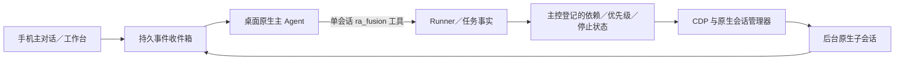

# Fusion：持续主 Agent 与后台子 Agent

本方案按 2026-11-05 用户确认的 Super Agent 方向实现，替代旧 run／最终文本控制块及专用子窗口流程。用户随后确认：优先使用单会话原生工具；子 Agent 与其原生会话持续保留，后续相同任务继续调用，不自动归档、关闭或释放上下文。

## 使用和边界

主页“概览｜项目｜收藏｜Fusion”共享电脑范围。进入 Fusion 只读状态。每个主工作台可以长期管理多个项目的工作项，不以某次交付结束整个工作台。

首次通过已有项目打开／新建／信任流程选择主项目，再选择主模型、思考强度及成本偏好。主项目窗口存在时复用，没有时使用普通打开项目流程。当前已验证的单会话工具主控为 Codex；Cursor 的窗口级 MCP 注册不能满足普通会话隔离，因此不注册 MCP，也不把 Cursor／Devin 宣称为已支持主控。

主 Agent 是普通桌面原生会话：进入后直接使用普通 Session 的发送、草稿、附件、排队／立即追加、问题、权限、模型、编辑器、终端和设置。Fusion 补充工作台设置及任务入口。桌面切到其他会话时，普通发送仍按原规则拒绝，不强行切回或清草稿。工作台另有文字收件箱，可交办新需求或补充指定工作／任务，由后台主控处理，手机收到的登记回执不冒充原生接受。

同软件子 Agent 在主窗口内使用独立原生会话；其他软件使用已经打开的原生窗口。子任务不会创建桌面窗口，不接管或清理普通会话，不出现在普通会话卡片中。原生软件自己的历史目录仍是事实来源。Fusion 展示主控、工作项、子任务、负责人、原生内容、输入和执行历史。没有该软件可用窗口、真实项目不匹配或后台交互能力不足时，显示实际原因，不通过切换普通会话绕过。

子 Agent 始终保留。`continue_task` 沿用对应负责人及原生会话，追加新的 Assignment／Attempt；换软件时留下旧 Binding，登记新的绑定。一次生成结束仅释放该次监听和连接，不自动归档、删除、隐藏或关闭子会话。共享窗口继续遵循原有普通窗口扫描、收藏及保留规则，没有 Fusion 专用窗口或第二套回收器。

## 唯一执行路径

不接模型 API、CLI Agent、外部 Harness；不写全局／项目 MCP 配置，不创建管理项目目录，不自动创建 worktree、合并、提交、推送或发布。Devin 原生 Fusion 模型模式不属于 RA 编排，保留原义。

Codex 动态工具随主会话创建。原生工具回执关联真实 thread、turn、request ID（包括数字 `0`）；Runner 生成自己的 decisionId。仅拦截登记主会话的 `ra_fusion`，其他会话和其他工具调用原处理器。子任务、历史或回复正文没有管理命令入口。重复原生请求返回已经持久登记的结果，不重复派工。

工具统一在 `control.mjs` 定义：读取工作台／任务／项目／真实模型，创建工作项、方案、派工、续接、评审、自己执行、等待、提问、取消、优先级与交付。参数或能力不符合时，原生工具收到具体错误。

## 状态、执行和恢复

- Controller 持续存在；WorkItem 有独立项目、计划版本、授权、完成标准及交付。
- Task 保留依赖、读写范围、验收、负责人、评审；Worker 保存原生上下文关联；Assignment 保存一次分配及其计划版本、模型／强度、输入与成本理由。
- Attempt 记录一次真实执行，分别保存提交、原生接受、生成结束和验收；Binding 保存 app／host／真实目录／窗口／thread。配置改变和补做不覆盖旧事实。
- 事件和待执行 Effect 与事实原子写入 Fusion 专用文件 `fusion.json`，不改普通 relay 状态存储。流式内容位于临时视图，不逐字重写持久历史。
- 主控处理已经到达的事件；没有新事件不调用模型。每个工作台只有一个管理轮次，同一任务原生执行未结束或结果未知时不能重复提交。
- 串并行由主控判断输入产出、文件、命令和共享资源的依赖与冲突，登记 `dependsOn` 或分批派工。relay 不按软件或项目限制并发，也不自动互斥同项目写任务；同软件的独立任务可并行，不同软件的依赖任务可串行。主控自己执行同样登记任务并遵守其前置依赖。
- 例如截图任务验收后才能修改依赖截图的 README；两个互不冲突的功能可以在同项目、同软件并行实现。集成与验证依赖相应实现任务，前置任务必须真正被验收。优先级只决定就绪任务的启动次序，不代表依赖。`access` 和 `scope` 保存授权与负责范围，不作为全项目锁。
- 当前调度策略随 `read_workspace` 返回，历史主会话复用已有 `dependsOn` 参数，不重建主会话。未知执行保留在原任务与 Attempt 中，主控先核对事实；不会占用全软件或全项目来阻塞其他独立任务。
- 执行前记录 Git／指定文件基线，现有改动不算本次成果。软件内置权限仍由其原生规则和用户决定。
- 子结果和问题进入有工作／任务归属的收件箱；主控验收、补做、自己处理或向用户提问。后台无法安全操作的原生交互保留等待并说明原因，不切换普通会话，不自动批准。
- 停止可针对任务、工作项或整个工作台。先取消未提交队列，只停止已核对的绑定及原生轮次；确认前保持 stopping，不能停止该会话后来产生的其他轮次。
- 手机离开、切页和断线不停止 Runner。relay 恢复核对已有原生会话与轮次：已运行的继续观察，已结束的收集，确定未提交的才提交；无法核对则 unknown／blocked，不自动重发。
- `finish` 是交付候选，逐项关联标准与证据；必需任务必须验收，不得有未知执行。还要等主控实际原生轮次完成并检查候选之后的新输入，才将该工作项记为完成。

## 能力与成本

均衡默认；省钱／均衡／性能只表达成本、时间和质量取舍，不限制模型名单或思考强度。主模型始终由用户选择，运行中的主模型修改使用原生菜单。

能力按需从当前原生窗口读取，保留原始 ID、标签、强度、价格／Free／倍率及读取来源、时间。Cursor Auto 保留原生 Auto，不猜内部模型。每次派工记录自做与委派比较及规划、评审、上下文传递、返工的总开销理由。金额未知标未知，不套 API 价推算订阅账单，也不把账户变化当任务精确费用。执行后记录可读原生用量及观察耗时。只有用户明确设置、且可用同一原生单位核对的预算才构成边界。

## 文件与切换

| 职责 | 文件 |
|---|---|
| 单一事实与原子持久化 | `server/fusion/state.mjs`、`store.mjs` |
| 单会话原生工具与主控观察 | `control.mjs`、`controller.mjs` |
| 事件、效果、停止和恢复 | `runner.mjs` |
| 依赖调度、主控决策顺序与窗口创建复用 | `scheduler.mjs` |
| 明确绑定的原生执行 | `agent.mjs`，复用 `native-windows.mjs` 和共享 page helpers 的显式上下文分支 |
| 实际能力与成本口径 | `cost.mjs` |
| 手机入口及主会话委托 | `owner.mjs`、`server/apps/fusion.mjs`、`app/js/fusion.js` |

旧 Fusion 不迁移、不执行旧协议。初始化先核对旧未结束 Attempt；仍有待核对执行时停止切换，不清理后重发。确认可切换后，将旧 `fusionRuns`／`fusionHistory`、旧 Fusion 选择及明确登记的专用窗口标记备份至 `_shots/fusion-superagent-cutover/`，只清除这些旧字段。原生历史、收藏、项目映射、其他 relay 状态和普通窗口保留。

`scripts/page-exports.json` 不修改。正式服务加载、发布、Git 提交／推送均须另有明确授权；本轮只在登记隔离服务和同一配对浏览器验收。

## 验证记录

本次以修改前干净 master `fdcde4a530e9f76b97d91d0429b7e93f258665c1` 为基准，实际 GitHub master 同一提交，debug 为 `fe013062b7c6499260e43b631eae0a64552525e6`。Node v22.16.0。产物位于 `_shots/fusion-superagent-implementation-20261105/`。

最终标准检查 `npm run check`：566/566 通过，语法、消息协议与 196 项 page 导出检查通过；`scripts/page-exports.json` 没有改动。最终日志为该目录的 `check-delivery-resumed.log`。两个真实终端测试通过后残留了它们自己的 Bash PTY；核实父进程后仅回收该测试资源，未修改终端产品代码或操作产品终端。

| 层次 | 本机结果 | 证据 |
|---|---|---|
| 受控检查 | 状态持久化、请求去重、DAG、验收／补做、三档与预算、事件合并、主控／Worker 调度、停止／恢复及普通路径回归通过 | 最终标准检查日志及 Fusion 定向日志 |
| Codex 单会话工具 | Luna／low 主会话收到真实工具请求 ID `0`，普通工具仍交回原处理器 | `codex-controller-turn.json` |
| 零子任务 | 普通主对话发送一次，原生回复 `fusion-zero-ok`，未创建子任务 | `zero-native-result.json` |
| 多子任务 | 两个独立 Codex 子会话在同一已有窗口执行；B 等待 A 被主控验收；逐项证据交付成功 | `native-execution-verification.json` |
| 子 Agent 续接 | 同一个 Worker、Binding、原生 thread 新增 Attempt；子任务执行期间，主控完成一次状态追问。测试输入把原 12 秒要求改成 25 秒，主控据此判定需要补做并提问；该新 Attempt 不记为完成 | 同上，及 `retained-worker-native-result.json` |
| Cursor 后台 | Auto 子会话有一次真实接受和完成，普通选择／草稿／模型快照保持一致；清理测试自己的内存引用后仍一致，原生会话保留 | `cursor-background-observed.json`、`cursor-test-cleanup.json` |
| 原生候选与成本 | 当前 Cursor 9 个候选（含原生 Auto）；Devin 912 个原生 ACP 型号／强度组合。没有可核实报价，金额均明确未知；未把 Normal／Fusion／Lite／Ultra 模式当成模型 | `native-candidates-current.json` |
| 配对浏览器 | v411 横竖屏四项底部导航可见；任务文字无横向溢出；前三项导航可切换、未发送草稿保留；按电脑展示工作台；无新增 Attempt／Binding，普通卡片没有 Worker | `browser-ui-final-result.json` 及 `*-final-*.png`；主对话顶部截图为 `main-current-*.png` |

本次浏览器使用既有配对身份，没有新建配对，没有发布网页。普通收藏页原本会回到全部电脑范围，该行为保留。主对话完整能力沿用普通 Session；真实图片／文件引用／终端及全部软件普通收发，仍须用户按受影响范围在手机验收，不能以菜单可见或受控测试替代。

收尾期间，Devin CDP 超时，用户报告 VS Code 卡死，Codex 的原窗口 target 随后已改变。测试工作台保留为 `blocked: CDP closed`，11 个 Attempt 均已结束，没有自动重发，也没有强行切回普通会话。原始普通选择与本次验收阶段之间存在无法完整解释的差异，且原窗口已失联，因此不宣称普通现场全部恢复。没有重启正式 relay、原生应用、提交、推送或发布。

用户恢复 VS Code 后，只读核对两个新窗口中均可读取原来的普通 Codex 会话，模型均为 GPT 6.1 Sol／Max、草稿长度均为零；没有改旧 Fusion Binding 来接管新窗口。证据为 `codex-after-user-freeze.json`。这不能替代普通功能真机回归，也不能据此判定卡死原因。

仍待验：运行中的真实停止和隔离 relay 重启恢复、跨软件的主控派工完整闭环、真实多工作项与三档选型、收藏回收、Devin Free High／历史 error 13、历史 Codex 草稿问题，以及用户手机验收。Cursor 问卷、Devin 交互和 Codex 未挂载的异步非阻塞问卷尚无已验证的后台操作接口，保留原生等待并显示错误原因；普通会话入口不变。不能把这些项目写成通过。

## 主 Agent 决定串并行：本轮验证补充

本轮以修改前干净工作区 `a03938f` 为基准，按用户确认移除软件单槽、项目写互斥及它们的未知执行占用；未知状态仍关联原任务，不能重复提交。沿用现有后台原生会话、`dependsOn`、优先级和停止能力。主控自己执行同样不持有全项目写锁。没有增加并发数量配置、文件锁、执行通道或旧协议兼容路径。

真实同软件验收首次暴露 `NativeWindow.composerCall()` 的冷启动并发定位冲突。受控测试在 `DOM.querySelector` 复现同一个 `Could not find node with given id`；用户追加批准共享模块的最小修改：同窗口只初始化一次页面上下文，初始化后的各原生调用仍并行。普通会话的发送、模型、草稿与轮次逻辑未修改。

本机产物：`_shots/fusion-task-scheduling-20261105/`。基准标准检查593/593，调度阶段 `npm run check -- -- --test-force-exit` 为599/599、定向47/47，包含共享初始化冲突、同软件与同项目独立写入并行、跨软件依赖串行、主控自己执行、乱序回执、多个未知轮次恢复、停止和连接释放。后续 Devin 失败回执补充两项回归后，最终标准检查601/601、该测试文件13/13。Node 官方退出选项用于既有测试句柄残留，没有修改测试检查器或 page 导出快照。

两条全新的真实 Codex Luna／low 子任务分别写本轮两个独立测试文件，使用同一个已有窗口中的不同原生 thread，各提交一次，两段接受至结束的区间重叠6.121秒，结果归属正确。第一次验收一个任务提交前失败、另一个完成；修复后按追加授权发送上述两条全新请求，没有重发旧请求。因此本轮共3条原生已接受请求，主控规划为受控调用，没有额外主模型请求；金额未知，原生用量不作为精确费用。

既有配对浏览器恢复后仍使用同一身份，没有新配对。在隔离临时标签中，以当前源函数投影和捕获的真实回复核对任务关系、内容归属、横竖屏、四项导航和未发送草稿，原配对页状态及存储指纹保持。该项使用受控读取回复，不冒充真实手机或完整 relay 原生闭环。五个 Codex 测试会话已通过已有原生归档能力整理，并核对原生归档文件。真实并行验收前后两个普通 Codex 窗口的选择、模型和草稿一致；之后另一次收尾核对观察到一个普通窗口新增17字符草稿，内容哈希不匹配测试文本，来源未确认，未清空或覆盖。后续只读检查及 Cursor 验收前后该窗口均为空，不能据此替前一处差异推断来源。

初次 Cursor／Devin CDP 无法连接，随后用户启动两者并明确允许继续测试。已读取当前原生 Auto（ID为default，不推断内部模型）和 SWE-2 High 候选。Cursor 两个只读后台任务各一次提交，使用同窗口不同 thread，真实区间重叠7.487秒；Cursor、Devin及两个Codex普通窗口在该阶段前后选择、模型与草稿一致。见 `other/cursor-result.json`。本阶段主控仅为受控规划身份，没有在普通Codex主会话注册工具或发送消息。

Devin任务分别依赖对应Cursor任务，Cursor结果尚未评审放行时均为queued/not_submitted；没有用“排队”冒充原生接受。用户明确确认SWE-2 High就是所指型号并允许测试后，受控验收Cursor结果，再提交两个Devin后台请求，各一次。实际接受时间相差16毫秒，两条均在对应Cursor验收之后开始；随后均收到原生 `Permission denied: internal server error: error number 13`，状态failed、会话idle。金额仍未知，没有把用户确认型号当成读取到了原生Free报价。原生error 13在本机重新复现，但没有正常回复，不能把Devin功能执行或并行验收记为通过。

该失败同时暴露Fusion回执问题：原生失败后移除了临时perSession消息状态，而后台内容仍直接读取该对象；轮次判断也只识别completed，导致本已失败的原生请求被记为unknown／stopping。用户追加批准仅修改 `server/page/chat-extract.js` 的Fusion显式Devin分支：按绑定会话及本次generationId读取原生request的failed终态和errorMessage；已失败且消息被移除时仍投影原错误，不吞成空成功，不改普通Devin的DOM读取和权限逻辑。两项回归修改前失败、修后通过，导出仍196项。

修后只观察现有两条请求通过实际Runner收尾，请求ID、原始终态及时间戳、接受事实、Attempt数量和Binding保持；原生prompt数仍为2，测试禁止所有nativeSessionAction，没有新增创建、配置、发送、停止或重发。由于先前测试超时已请求停止，收尾状态为stopped、completed=false，保留各自原生error 13，并非成功完成；监听和执行连接均已释放。观察阶段前后Cursor／Devin普通窗口选择、模型与草稿一致。证据为 `other/devin-receipt-recovery.json`；之前Devin验收的另一Codex窗口曾从空选择恢复原thread，来源未确认，未强行恢复，不宣称全部现场始终一致。

跨软件的前置验收约束已在真实提交时核对，但Devin正常完成、真实主模型自行规划的跨软件闭环、运行中真实停止／断线恢复和用户手机验收仍待验。正式 relay 未由本轮重启加载，原 README 工作没有继续：仍9个 Attempt、3条待处理事件，停止请求保持。现场状态为 stopping，不能声称已核实全部停止或新调度已经正式生效；本轮没有修改正式数据来改变这个状态，也没有提交、推送或发布。
